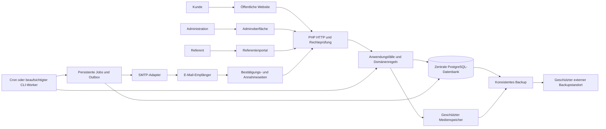
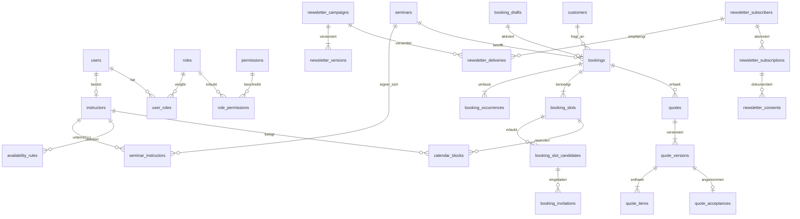
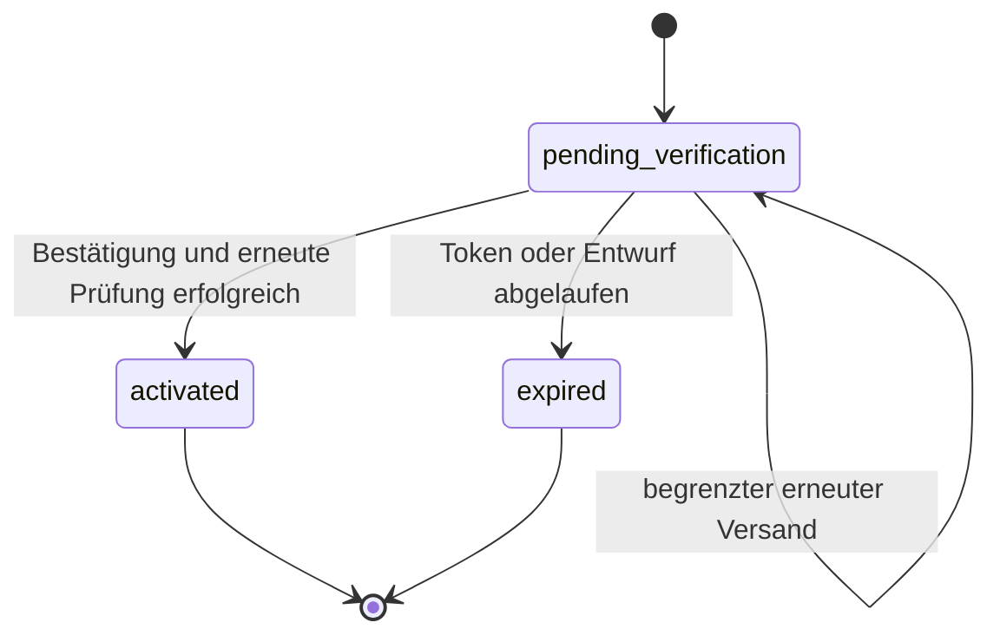
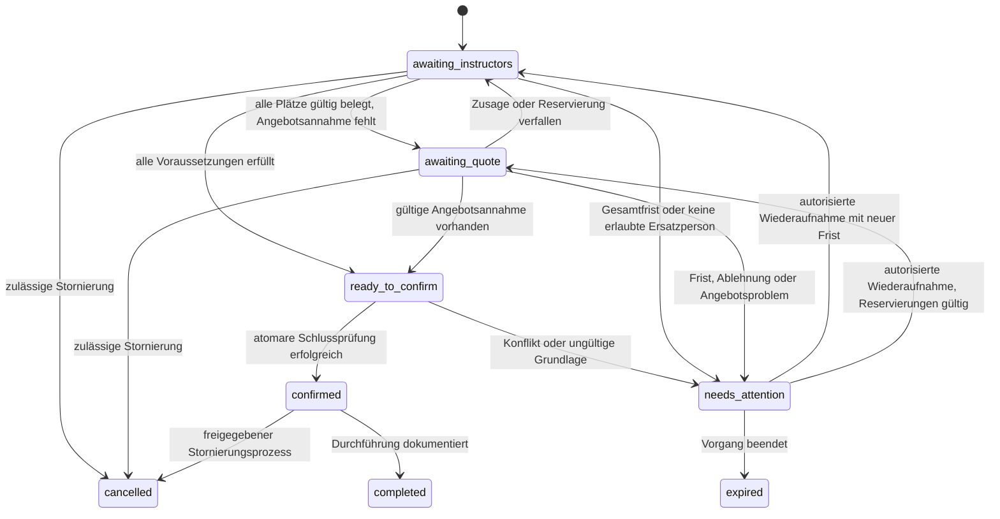

# Corpsakademie 2.0 – Architektur und Anforderungsvalidierung

Version 0.1 · 24. Oktober 2026 · Status: zur fachlichen und technischen Freigabe

Umsetzungsnachtrag: Die lokale Entwicklungsumgebung sowie das erste ausführbare Fundament und Identitätsmodul wurden nach schrittweiser Freigabe umgesetzt. Der tatsächliche Stand ist in [Fundament](FUNDAMENT.md) dokumentiert. Die übrigen Module dieses Gesamtentwurfs und die offenen Geschäftsentscheidungen bleiben geplant beziehungsweise freizugebend.

Grundlage ist die vom Auftraggeber übergebene konsolidierte Spezifikation „Corpsakademie 2.0“, Version 2.0. Dieses Dokument beschreibt das geplante Gesamtsystem. Es enthält keine implementierten Funktionen, keine ausführbaren Migrationen und keine Zusage einer bereits geprüften Hostingkompatibilität. Die Programmierung beginnt gemäß Auftrag erst nach Freigabe. Vorschläge zu noch offenen Geschäftsregeln sind ausdrücklich unverbindlich.

## 1. Interpretation und Anforderungsvalidierung

Entwickelt wird eine individuell programmierte Seminarplattform mit drei Oberflächen: öffentliche Website, Administration und Referentenportal. Alle verwenden dieselben Geschäftsregeln und eine zentrale PostgreSQL-Datenbank. Kern ist die zuverlässige Koordination individueller Seminaranfragen vom verifizierten Kundenkontakt über Referentenzusagen und Angebote bis zur verbindlichen Terminbestätigung.

Verbindliche technische Vorgaben sind PHP, PostgreSQL, HTML, CSS und JavaScript, mobile Bedienbarkeit, echte serverseitige Funktionen, ein eigenes Verwaltungsbackend, automatisierte Tests und ein reproduzierbarer Serverwechsel. WordPress, ein fertiges CMS, ein allgemeiner Seiteneditor und Onlinezahlung gehören nicht zum Umfang. Bibliotheken für technische Aufgaben bleiben ausdrücklich sinnvoll.

Die öffentliche Gestaltung folgt Marineblau, Gold und Weiß sowie festen Seitentypen. Die erwähnten Mockups liegen im Projektordner nicht vor. Es werden deshalb noch keine daraus abgeleiteten Gestaltungsvorgaben behauptet. Die bestehende Website besitzt bereits Themenbereiche und eine Terminseite; deren Inhalte, Datenqualität und Rechte müssen vor einer Übernahme einzeln inventarisiert werden. Die bestehende Terminseite allein belegt kein Modell öffentlicher Einzelplatzbuchungen. [Bestehende Website](https://www.corpsakademie.de/)

### 1.1 Verbindlich, vorgeschlagen und offen

| Einordnung | Inhalt | Konsequenz |
|---|---|---|
| Verbindlich | E-Mail-Bestätigung vor Aktivierung einer Anfrage | Keine Referenteneinladung und keine dauerhafte Reservierung davor |
| Verbindlich | Vier Referentenmodi und mehrere benötigte Personen | Individuelle Referentenplätze mit erlaubten Kandidaten und Ersatzfreigaben |
| Verbindlich | Erinnerung nach 24/48 Stunden, Ablauf nach 72 Stunden | Fristen pro Einladung; jede Maßnahme wird höchstens einmal fachlich erzeugt |
| Verbindlich | Individuelles Angebot muss vor Buchungsbestätigung angenommen sein | Referentenzusage allein begründet keine kostenpflichtige Kundenbestellung |
| Verbindlich | Preise werden nicht erfunden | Ohne freigegebene Regel: „Preis auf Anfrage“ |
| Verbindlich | Newsletter mit gesondertem Double-Opt-in | Buchungsbestätigung ist keine Newslettereinwilligung |
| Architekturvorschlag | Modularer Monolith, eine aktive Installation, zentrale PostgreSQL-Datenbank | Gemeinsame, kurze Transaktionen und ein zentral verwalteter Datenspeicher |
| Architekturvorschlag | Einladungen reservieren noch keinen Referenten; eine gültige Zusage erzeugt eine befristete Belegung | Verhindert, dass eine Anfrage alle angeschriebenen Referenten sperrt; fachlich freizugeben |
| Offen | Gesamtfrist, Reservierungsdauer, Annahmebedingungen, Stornierungen | Keine automatische verbindliche Buchung, solange diese Regeln fehlen |
| Offen | Individuelle Gruppenseminare oder zusätzlich feste öffentliche Veranstaltungen mit Einzelplätzen | Vor Buchungsmodell freigeben; Einzelplätze erfordern eine zusätzliche Veranstaltungs- und Kapazitätsverwaltung |

### 1.2 Ergänzungen und Widersprüche

1. „Vollständig serverunabhängig“ bedeutet unabhängig vom Anbieter auf einer kompatiblen Infrastruktur. PHP-CLI, Dateisystem-Locking, Speicher, TLS und ein geeigneter Versandweg bleiben Voraussetzungen.
2. WAL verbessert Leseparallelität, hebt aber die Serialisierung von Schreibzugriffen nicht auf. Newsletter, Sitzungen und Rate-Limits teilen sich denselben Schreibzugang.
3. „Keine doppelten Sendungen“ ist innerhalb der Anwendung als eindeutiger Versandauftrag erreichbar. Eine absolut einmalige Zustellung über gewöhnliches SMTP ist bei Verbindungsabbruch nach Annahme nicht beweisbar. Unklare Versandfälle benötigen einen eigenen Zustand.
4. Ein Newsletter kann bei großem Verteiler nicht gleichzeitig an alle Empfänger gehen. Planung definiert den Versandbeginn; tatsächliche Dauer hängt von Versandlimits ab.
5. Kunden müssen zwischen unverbindlicher Orientierung, freigegebenem Angebot, eigener Annahme und verbindlicher Buchungsbestätigung unterscheiden können.
6. Ein angenommener Kostenvoranschlag ist noch keine Termingarantie, falls notwendige Referentenbelegungen inzwischen ungültig sind. In diesem Fall wird eine Klärung ausgelöst.
7. Sicherheitstokens werden als Prüfhäshe gespeichert. Für den späteren Mailversand notwendige Tokenwerte liegen nur vorübergehend verschlüsselt in der Outbox; Klartextlinks dürfen nicht in Datenbankprotokolle oder Logs gelangen.
8. Ein System, dessen Cron vollständig ausgefallen ist, kann sich nicht zuverlässig selbst per E-Mail melden. Für die Produktionsüberwachung ist ein außerhalb dieses Ausführungspfads laufender Lebenszeichencheck erforderlich.

## 2. Geplante Module

| Modul | Fachlicher Umfang | Oberflächen und wesentliche Abhängigkeiten |
|---|---|---|
| Plattformkern | Konfiguration, Container, HTTP, CLI, Fehler, Zeitdienst, Transaktionen | Grundlage aller Module |
| Identität und Rechte | Login, MFA, Sitzungen, Reset, Kontofreigabe, Rechteprüfung | Administration und Referentenportal |
| Seminarkatalog | Kategorien, Zielgruppen, Dauer, Format, Lernziele, Medien, Versionen | Öffentliche Suche und Detailseiten; Admin-Assistent |
| Referenten | Öffentliches Profil, private Daten, Qualifikationen, Seminarzuordnung | Profile, Admin-Verwaltung, eigenes Profil |
| Verfügbarkeit | Tages-/Wochen-/Monatsansicht, lokale Wochenregeln, Ausnahmen, Urlaub, Sperren | Referentenkalender und freie Kundentermine |
| Buchungsanfrage | Entwurf, Kontaktdaten, Termin, Personenzahl, Auswahlmodus, Verifikation | Öffentlicher Buchungsassistent |
| Buchungskoordination | Plätze, Kandidaten, Einladungen, Antworten, Ersatz, Reservierung, Bestätigung | Admin-Buchungen und Referentenanfragen |
| Erinnerungen und Eskalationen | 24/48/72 Stunden, Gesamtfrist, kontrolliertes Wiederaufnehmen | Dashboard und Vorgangsverlauf |
| Preisberechnung | Versionierte Regeln, Kostenschätzung, unbekannte Kostenbestandteile | Öffentliche Orientierung und Administration |
| Angebote | Positionen, Versionen, Freigabe, Nummern, PDF, Versand, Annahme, Ablauf | Admin-Angebote und geschützter Kundenlink |
| Newsletter-Redaktion | Strukturierte Blöcke, Vorlagen, Vorschau, Testmail, Duplizieren | Eigener Newsletter-Builder, kein allgemeiner Seiteneditor |
| Newsletter-Empfänger | Double-Opt-in, Listen, Segmente, Abmeldung, Sperren, Einwilligungsnachweise | Öffentliche Anmeldung und Admin-Verwaltung |
| Newsletter-Versand und Archiv | Zeitplanung, unveränderliche Versandversion, Empfängerliste, Batches, Historie | Internes Archiv; öffentlich nur bei Freigabe |
| Nachrichten | Vorlagen, Absenderprofile, verschlüsselte Outbox, Versandereignisse, Bounces | Alle fachlichen Module |
| Hintergrundverarbeitung | Persistente Queue, Beanspruchung, Leases, Wiederholungen, fehlgeschlagene Jobs | CLI und Systemstatus |
| Betrieb und Datenschutz | Installation, Migrationen, Backups, Restore, Aufbewahrung, Export, Diagnose | Superadministration und Betrieb |
| Öffentliche Website | Start, Katalog, Details, Referenten, Kontakt, rechtliche Seiten, Newsletter | Festes Design; integrierte Fachmodule |
| Qualitätssicherung | Fachtests, Integration, Parallelität, Browserabläufe, Sicherheit, Barrierefreiheit | Verbindliche Abnahme je Modul |

Das Dashboard liest die vorhandenen Fachzustände. Es führt keine eigene, abweichende Buchungslogik ein. Offene Zusagen, Eskalationen, Angebotsfreigaben, fehlgeschlagene Nachrichten und überfällige Jobs bleiben unmittelbar erreichbar.

## 3. Bewertung von PHP, PostgreSQL und Hosting

### 3.1 Zielstack

Empfehlung: PHP 8.5 mit aktuellem Sicherheitsstand, Kompatibilität mit PHP 8.4 nach Prüfung. PHP 8.5 erhält laut PHP-Projekt aktive Unterstützung bis Ende 2027 und Sicherheitsunterstützung bis Ende 2029. Die Version wird mit dem tatsächlichen Zielhosting abgeglichen. [PHP-Supportzeiträume](https://www.php.net/supported-versions.php)

Die Anwendung wird ein modularer Monolith mit vier Schichten:

- **Darstellung:** Controller, HTML-Templates, Formulare und kleine JSON-Endpunkte.
- **Anwendung:** explizite Anwendungsfälle wie Anfrage aktivieren, Einladung annehmen und Angebot freigeben.
- **Domäne:** Zustandsautomaten, Fristen, Berechtigungsregeln, Preis- und Verfügbarkeitsregeln.
- **Infrastruktur:** PDO-PostgreSQL, Dateispeicherung, SMTP, PDF, Queue und Protokollierung.

Geschäftslogik liegt weder in Templates noch in JavaScript. HTTP und CLI rufen dieselben Anwendungsfälle auf. Repositories erhalten für zusammenhängende Änderungen dieselbe Datenbankverbindung. Es gibt keinen zweiten Serverdienst, der Buchungen unabhängig verändert.

Geplant sind Composer und PSR-4, ein schlanker Router, ein Template-System mit automatischem Escaping, bewährte Komponenten für Mail/CLI und eine gepflegte PHP-PDF-Bibliothek. Konkrete Pakete und Versionen werden nach Kompatibilitäts-, Lizenz- und Sicherheitsprüfung festgeschrieben. Beispielsweise kommen Symfony-Komponenten, Twig, Dompdf und PHPUnit infrage. Docker ist für Entwicklung möglich, auf dem Kundenserver aber keine Pflicht. Fertige Releases enthalten die benötigten Produktionsabhängigkeiten und gebaute Assets; Node.js ist keine Voraussetzung im Produktivbetrieb.

### 3.2 PostgreSQL-Eignung

Für eine einzelne Plattform mit moderatem Schreibaufkommen ist ein zentraler PostgreSQL-Server die tragfähige Wahl: Er erlaubt gleichzeitige Schreibverbindungen, echte Zeilensperren und eine serverseitig erzwungene Fremdschlüssel- und Integritätsprüfung. Auf Shared Hosting wird der Server vom Anbieter betrieben; die Anwendung spricht ihn ausschließlich über `APP_DB_HOST`, `APP_DB_PORT`, `APP_DB_NAME`, `APP_DB_USER` und `APP_DB_PASSWORD` aus `shared/.env` an. Zugangsdaten stehen damit nie im Webroot und nie im Git-Repository.

Vorgesehen sind kurze Transaktionen mit `PDO::beginTransaction`/`commit`, serverseitige Fremdschlüssel und Identity-Spalten sowie Zeilensperren für konkurrierende Vorgänge. Kritische Abläufe serialisieren über `SELECT … FOR UPDATE` beziehungsweise `FOR UPDATE SKIP LOCKED`, nicht über eine Dateisperre. Fehler werden begrenzt und idempotent wiederholt, niemals als unkontrolliert wiederholte Teiländerungen.

**Aktuelle Voraussetzung:** PostgreSQL ab Version 10. Identity-Spalten (`GENERATED BY DEFAULT AS IDENTITY`), `jsonb`, `ON CONFLICT … DO UPDATE`, `count(*) FILTER` und `FOR UPDATE SKIP LOCKED` sind ab dieser Version verfügbar. PostgreSQL 10 ist seit November 2022 ohne Herstellersupport; die Anwendung ist so gebaut, dass auch aktuell gepflegte Server ohne Codeänderung genutzt werden können, und produktiv ist ein gepflegter Server vorzuziehen.

Bei Lastproblemen werden zuerst unnötige Schreibvorgänge reduziert, Newsletterbatches begrenzt, Abfragen indexiert und der Host vertikal erweitert. Ein Wechsel des Datenbanksystems wäre eine neue, ausdrücklich zu entscheidende Architekturänderung.

### 3.3 Verbindliche Hostingprüfung vor Installation

| Prüffeld | Erforderlicher Nachweis |
|---|---|
| PHP-Web und PHP-CLI | Unterstützte, kompatible Versionen; identische relevante Erweiterungen |
| Erweiterungen | PDO_PGSQL/PGSQL, mbstring, intl, fileinfo, OpenSSL, Sodium sowie Bild-/XML-Erweiterungen der gewählten Bibliotheken |
| PostgreSQL | Erreichbare Serverversion ab 10, Identity-Spalten, `jsonb`, Fremdschlüssel und `FOR UPDATE SKIP LOCKED` funktionieren; `pg_dump`/`psql` für Sicherung und Wiederherstellung vorhanden |
| Dateisystem | Lokaler beschreibbarer Bereich außerhalb des Webroots; verlässliches Locking; Platz für Protokolle, Medien und Sicherungen |
| Webserver | Nur `public/` öffentlich; Routing, TLS, Sicherheitsheader; alternative sichere Webroot-Konfiguration bei Shared Hosting |
| Hintergrundjobs | PHP-CLI und zulässiger Cron; Laufzeit-, Prozess- und Speicherlimits bekannt |
| Versand | TLS-SMTP, erlaubte Absender, Domainauthentifizierung, Versandquoten, Bounce-Zugang |
| Betriebszugang | Releaseupload, Geheimnisverwaltung, gesicherter Backupabzug, Wiederherstellung und Protokollzugang |
| Kapazität | Gleichzeitige Buchungsanfragen und vereinbartes Newslettervolumen unter repräsentativer Last getestet |

Namecheap Shared Hosting erlaubt laut Dokumentation keine Cron-Intervalle unter fünf Minuten. Der Worker muss deshalb auch in begrenzten CLI-Läufen arbeiten können. Eine dortige Zeitplanung bedeutet „ab diesem Zeitpunkt, beim nächsten erfolgreichen Lauf“, mit mindestens der entsprechenden Ausführungstoleranz. [Namecheap-Cronregeln](https://www.namecheap.com/support/knowledgebase/article.aspx/9453/29/how-to-run-scripts-via-cron-jobs/)

Der dokumentierte Mailrahmen variiert unter anderem von 50 Nachrichten pro Stunde bei Stellar bis zu 200 bei Stellar Plus. Die konkrete Quote wird aus dem gebuchten Produkt übernommen; Transaktionsmails erhalten reservierte Kapazität vor Newslettern. Ein großer Verteiler kann einen separaten SMTP-Anbieter erfordern. Eine Auswahl erfolgt erst nach Festlegung des Volumens. [Namecheap-Versandlimits](https://www.namecheap.com/support/knowledgebase/article.aspx/133/22/do-you-have-any-restrictions-on-sending-out-emails/)

**Bewertung:** PHP mit PostgreSQL ist technisch schlüssig. Die Eignung eines konkreten Namecheap-Tarifs bleibt offen, bis diese Prüfung bestanden wurde. Wenn PostgreSQL-Erreichbarkeit, CLI oder Fristen nicht tragfähig sind, wird ein kompatibler Hostingtarif oder VPS benötigt.

## 4. Gesamtsystem, Datenflüsse und Schnittstellen



Ein Kunde legt zunächst einen Entwurf an. Die Transaktion speichert den Entwurf, den gehashten Verifikationstoken und den verschlüsselten Versandauftrag. Nach ausdrücklicher Bestätigung aktiviert ein Anwendungsfall den Vorgang, prüft die aktuelle Verfügbarkeit und erzeugt Plätze und Einladungen. Zusagen, Fristen und Angebotsannahmen führen stets durch dieselbe zentrale Neubewertung. Die finale Transaktion prüft sämtliche Bedingungen, wandelt gültige Reservierungen in feste Belegungen um und schreibt Bestätigungsmails in die Outbox.

### 4.1 Geplante Verzeichnisstruktur

```text
app/
  Domain/{Identity,Seminars,Instructors,Availability,Bookings,Pricing,Quotes,Newsletter}
  Application/
  Infrastructure/{Database,Mail,Queue,Media,Security,Monitoring}
  Http/{Controllers,Middleware,Validation}
bin/                  CLI-Einstiegspunkte
bootstrap/            Initialisierung
config/               Konfigurationsschema ohne Geheimnisse
database/migrations/  Versionierte Migrationen
resources/{views,emails,assets}/
public/               Einziger Webroot: Frontcontroller und veröffentlichte Assets
storage/              Konfigurierbarer privater Laufzeitbereich
tests/{Unit,Integration,Concurrency,EndToEnd}/
docs/                 Architektur und Betriebsanleitungen
```

Datenbankzugang, Originaluploads, Angebote, Logs und Backups liegen außerhalb von `public/`. Öffentliche Bildvarianten werden kontrolliert bereitgestellt. Referenten- und Kundendokumente werden nur über berechtigte Downloadendpunkte ausgeliefert.

### 4.2 Schnittstellenkonzept

| Bereich | Beispielroute | Schutz und Verhalten |
|---|---|---|
| Katalog | `GET /seminare`, `GET /seminare/{slug}` | Nur veröffentlichte Inhalte; serverseitige Suche und Filter |
| Verfügbarkeit | `GET /api/v1/availability` | Begrenzter Zeitraum; nur freie Zeitfenster, keine privaten Kalenderdetails |
| Anfrage | `POST /anfragen` | Formularschutz, Validierung, Rate-Limit, Idempotenz; erzeugt nur Entwurf |
| Verifikation | `GET /bestaetigen/{token}`, danach `POST` | GET zeigt Bestätigungsseite; POST aktiviert einmalig |
| Angebotsannahme | Geschützte Ansicht und `POST /angebote/{public_id}/annehmen` | Token an konkrete Version gebunden; ausdrückliche Annahme |
| Referenten | `/portal/*` und POST-Antworten auf Einladungen | Login, Datensatzbesitz, CSRF und atomare Fristprüfung |
| Administration | `/admin/*` | Login, MFA, spezifische Berechtigung je Aktion |
| Newsletter | Anmeldung, DOI-Seite, Abmeldung | Eigene Einwilligung; Abmeldung ohne Login |
| System | CLI-Kommandos | Kein öffentlich erreichbarer Cron- oder Migrationstrigger |

GET verändert keine Buchung, Einladung oder Angebotsannahme. Damit lösen E-Mail-Linkscanner keine Geschäftsentscheidungen aus. JSON dient der eigenen Oberfläche, nicht zunächst einer öffentlichen Partner-API. Listen sind paginiert; Fehlermeldungen geben keine fremden Datensätze oder Konten preis. Ungültige Eingaben, fehlende Rechte, Statuskonflikte und Rate-Limits erhalten unterscheidbare technische Antworten und verständliche Meldungen. Mutationen verwenden Idempotenzschlüssel und bei redaktionellen Änderungen Versionsnummern gegen überschriebenen Bearbeitungsstand.

## 5. Vollständiges logisches Datenbankmodell

Dieses Modell deckt den spezifizierten Umfang individueller Seminaranfragen ab. Öffentliche Einzelplatzveranstaltungen sind eine offene Umfangsentscheidung und werden nicht durch bloßes Umbenennen von Gruppenbuchungen vorgetäuscht.

### 5.1 Konventionen und Typen

- `I` = INTEGER, `T` = TEXT, `B` = BLOB, `J` = TEXT mit gültigem JSON, `?` = nullable. `UQ` bezeichnet Eindeutigkeit, `FK` einen echten Fremdschlüssel.
- Jede Tabelle besitzt, soweit nicht ein zusammengesetzter Primärschlüssel angegeben ist, `id I PRIMARY KEY`. Veränderliche Tabellen haben `created_at I`, `updated_at I` und `row_version I`; Ereignis- und Versionstabellen nur passende Erstellungszeitpunkte.
- Zeitpunkte sind UTC-Epoch-Sekunden als INTEGER. Lokale Wiederholungsregeln speichern zusätzlich IANA-Zeitzone, Wochentag, lokale Uhrzeit und Gültigkeitsdaten. Datumswerte ohne Uhrzeit sind ISO-Datums-TEXT.
- Wahrheitswerte sind INTEGER mit CHECK auf 0/1. Zustände sind TEXT mit CHECK auf die erlaubte Wertemenge. Pflichtfelder sind NOT NULL, soweit nicht `?` angegeben.
- Öffentliche Vorgänge erhalten zusätzlich `public_id T UQ` mit nicht erratbarem Zufallswert. Das ersetzt niemals eine Rechteprüfung.
- Geldbeträge sind INTEGER in kleinster Währungseinheit, Währung ist ISO-Code als TEXT. Mengen und Sätze verwenden fest definierte Dezimalskalierung, keine Fließkommazahlen.
- JSON enthält strukturierte Inhalte, Regelparameter und unveränderliche Snapshots. Suchbare Beziehungen, Plätze und Empfänger werden relational gespeichert.

### 5.2 Identität, Rechte und Sicherheit

| Tabelle | Felder zusätzlich zum Basisschlüssel | Beziehungen und Integrität |
|---|---|---|
| `users` | email T, email_key T UQ, password_hash T, name T, status T, email_verified_at I?, password_changed_at I?, disabled_at I? | Keine öffentlichen Kundenkonten erforderlich; E-Mail-Schlüssel nach dokumentierter Normalisierung, ohne anbieterspezifisches Entfernen von Punkten oder Plus-Suffixen |
| `roles` | code T UQ, label T, protected I | Superadmin, Admin, Referent |
| `permissions` | code T UQ, description T | Stabile, versionierte Rechtecodes |
| `user_roles` | user_id I FK users, role_id I FK roles | PK(user_id, role_id) |
| `role_permissions` | role_id I FK roles, permission_id I FK permissions | PK(role_id, permission_id) |
| `sessions` | user_id I FK users, session_hash T UQ, payload_ciphertext B, key_id T, last_seen_at I, idle_expires_at I, absolute_expires_at I, revoked_at I? | Keine Klartext-Sitzungskennungen; serverseitig widerrufbar |
| `user_mfa_factors` | user_id I FK users, kind T, secret_ciphertext B, key_id T, confirmed_at I?, last_counter I?, disabled_at I? | MFA-Geheimnis verschlüsselt; Zähler schützt gegen Wiederverwendung |
| `mfa_recovery_codes` | user_id I FK users, code_hash T UQ, used_at I? | Einmalverbrauch atomar |
| `email_verification_tokens` | purpose T, token_hash T UQ, user_id I? FK users, draft_id I? FK booking_drafts, subscription_id I? FK newsletter_subscriptions, quote_version_id I? FK quote_versions, invitation_id I? FK booking_invitations, email_key T, expires_at I, consumed_at I?, revoked_at I? | Genau ein passender fachlicher Bezug je Zweck; auch Kontoaktivierung/Reset und Angebotszugang; DOI bestätigt eine konkrete Liste; keine universellen Berechtigungslinks |
| `rate_limit_buckets` | scope T, subject_hmac T, window_start I, hits I, expires_at I | UQ(scope, subject_hmac, window_start); atomare Inkremente |
| `idempotency_records` | scope T, actor_key T, request_key T, request_hash T, result_ref T?, expires_at I | UQ(scope, actor_key, request_key); gleiche ID mit anderem Inhalt wird abgewiesen |
| `audit_logs` | actor_user_id I? FK users, action T, entity_type T, entity_public_id T, changes_redacted J, correlation_id T, occurred_at I | Referenzbeschreibung bewusst unabhängig vom später gelöschten Datensatz; keine Tokens oder geheimen Inhalte |
| `security_events` | actor_user_id I? FK users, type T, severity T, subject_hmac T?, details_redacted J, occurred_at I, retain_until I | Sicherheitsprotokoll mit begrenztem Zugriff |

### 5.3 Katalog und Referenten

| Tabelle | Felder | Beziehungen und Integrität |
|---|---|---|
| `seminars` | public_id T UQ, slug T UQ, title T, short_description T, description T, learning_goals J, duration_minutes I, duration_layout J, format T, min_participants I, max_participants I?, status T, featured I, archived_at I? | Dauer > 0; 0 < Minimum <= Maximum; Status Entwurf/veröffentlicht/inaktiv/archiviert |
| `seminar_categories` | slug T UQ, title T, position I | Kategorienkatalog |
| `seminar_category_links` | seminar_id I FK seminars, category_id I FK seminar_categories | Zusammengesetzter PK |
| `target_groups` | slug T UQ, title T | Zielgruppenkatalog |
| `seminar_target_groups` | seminar_id I FK seminars, target_group_id I FK target_groups | Zusammengesetzter PK |
| `media_files` | storage_key T UQ, original_name T, mime_type T, byte_size I, sha256 T, width I?, height I?, visibility T, uploaded_by I? FK users, alt_text T?, deleted_at I? | Speicherpfade werden generiert; Dateityp und Inhalt geprüft |
| `seminar_media` | seminar_id I FK seminars, media_id I FK media_files, position I, purpose T | UQ(seminar_id, media_id, purpose); höchstens ein Titelbild per partiellem Unique-Index |
| `seminar_versions` | seminar_id I FK seminars, version I, content_snapshot J, content_hash T, author_id I? FK users, created_at I | UQ(seminar_id, version); unveränderlicher Stand für bestehende Buchungen |
| `instructors` | user_id I FK users UQ, public_id T UQ, first_name T, last_name T, phone T?, biography T, expertise J, profile_media_id I? FK media_files, publication_status T, active I, public_contact_consent_at I? | Öffentliche Projektion enthält nur freigegebene Felder; Kontaktadresse kommt aus Konto und bleibt privat |
| `instructor_qualifications` | instructor_id I FK instructors, title T, description T?, verified_at I?, position I | Keine unkontrolliert öffentlichen Nachweisdokumente |
| `seminar_instructors` | seminar_id I FK seminars, instructor_id I FK instructors, active I, replacement_priority I? | PK(seminar_id, instructor_id); Priorisierung nur nach freigegebener Regel |
| `contact_requests` | public_id T UQ, name T, email T, subject T, message T, status T, retain_until I | Rate-Limit und Formularschutz; private Anfragen |

### 5.4 Verfügbarkeit und Buchungen

| Tabelle | Felder | Beziehungen und Integrität |
|---|---|---|
| `availability_rules` | instructor_id I FK instructors, timezone T, weekday I, local_start T, local_end T, valid_from T, valid_until T?, active I | Wochentag 1–7; lokale Uhrzeiten validiert; über Mitternacht laufende Regeln werden geteilt |
| `availability_exceptions` | instructor_id I FK instructors, start_at I, end_at I, kind T, private_note T? | Zusatzverfügbarkeit oder Sperrzeit; end > start; Sperre hat Vorrang |
| `customers` | public_id T UQ, name T, organization T?, email T, email_key T, phone T?, address J?, verified_at I? | Kein stilles Zusammenführen von Kontakten anhand einer unbestätigten Adresse |
| `booking_drafts` | public_id T UQ, seminar_id I FK seminars, customer_data_ciphertext B, key_id T, request_payload J, state T, expires_at I, activated_at I? | Unbestätigt, aktiviert, abgelaufen; keine dauerhaften Kalenderblöcke |
| `booking_policy_versions` | version I UQ, config J, approved_by I? FK users, approved_at I?, effective_from I? | Unveränderliche Fristen-/Ersatz-/Bindungsregeln; nicht freigegebene Version ist produktiv unzulässig |
| `bookings` | public_id T UQ, draft_id I FK booking_drafts UQ, customer_id I FK customers, seminar_id I FK seminars, seminar_version_id I FK seminar_versions, policy_version_id I FK booking_policy_versions, status T, instructor_mode T, participants I, location J, timezone T, activated_at I, overall_deadline_at I, quote_required I, accepted_quote_version_id I? FK quote_versions, terms_snapshot J, confirmed_at I?, cancelled_at I?, completed_at I? | Teilnehmergrenzen geprüft; Seminarversion gehört zum Seminar; akzeptierte Angebotsversion gehört zur Buchung |
| `booking_occurrences` | booking_id I FK bookings, sequence I, start_at I, end_at I, buffer_before_minutes I, buffer_after_minutes I | UQ(booking_id, sequence); end > start; mehrtägige Seminare erhalten mehrere Zeitintervalle |
| `booking_slots` | booking_id I FK bookings, position I, label T, selection_scope T, mandatory_instructor_id I? FK instructors, replacement_allowed I, status T, assigned_instructor_id I? FK instructors, accepted_until I? | UQ(booking_id, position); verpflichtende Person darf nicht still ersetzt werden |
| `booking_slot_candidates` | slot_id I FK booking_slots, instructor_id I FK instructors, source T, priority I?, allowed_at I, allowed_by I? FK users, consent_snapshot J? | PK(slot_id, instructor_id); explizite Auswahl oder dokumentierte Ersatzfreigabe |
| `booking_invitations` | slot_id I, instructor_id I, round I, status T, activated_at I, reminder_1_at I, reminder_2_at I, expires_at I, responded_at I?, acceptance_valid_until I?, response_reason T? | Zusammengesetzter FK(slot_id, instructor_id) auf Kandidaten; UQ(slot_id, instructor_id, round); Fristen aus Policy-Snapshot |
| `calendar_blocks` | instructor_id I FK instructors, occurrence_id I? FK booking_occurrences, slot_id I? FK booking_slots, type T, start_at I, end_at I, state T, expires_at I?, released_at I? | Typ Urlaub/manuelle Sperre/Reservierung/Buchung; state active/confirmed/released/expired; end > start; Reservierung braucht Ablauf; passende Referenten-/Slotzuordnung prüfen |
| `booking_events` | booking_id I FK bookings, event_key T UQ, type T, actor_user_id I? FK users, payload_redacted J, occurred_at I | Unveränderlicher fachlicher Verlauf |
| `booking_workflows` | booking_id I FK bookings UQ, next_action_at I?, round I, stopped_at I?, stop_reason T?, attention_reason T?, resumed_by I? FK users | Bearbeitung, Eskalation und kontrollierte Wiederaufnahme |

Kandidaten werden bei Aktivierung als freigegebener Auswahlumfang festgehalten. Für Modus „beliebig“ dürfen später weitere geeignete Personen nur nach der gespeicherten Auswahlregel ergänzt werden. Einladungsrunden umgehen weder eine namentliche Bindung noch eine fehlende Ersatzfreigabe.

### 5.5 Preise und Kostenvoranschläge

| Tabelle | Felder | Beziehungen und Integrität |
|---|---|---|
| `pricing_rules` | code T UQ, label T, active I | Identität einer administrativ gepflegten Preisregel |
| `pricing_rule_versions` | pricing_rule_id I FK pricing_rules, version I, model T, currency T, calculation_parameters J, tax_policy_snapshot J, valid_from I?, valid_until I?, approved_by I? FK users, approved_at I? | UQ(pricing_rule_id, version); unveränderliche veröffentlichte Regel; keine freie Codeausführung |
| `seminar_pricing_rules` | seminar_id I FK seminars, pricing_rule_id I FK pricing_rules | PK(seminar_id, pricing_rule_id); Anwendungsreihenfolge muss eindeutig sein |
| `quote_number_sequences` | series T, year I, next_value I | PK(series, year); Nummernvergabe in derselben Schreibtransaktion |
| `quotes` | public_id T UQ, booking_id I FK bookings, number T UQ, status T, created_by I FK users, withdrawn_at I? | Status Entwurf/in Prüfung/freigegeben/versendet/angenommen/abgelehnt/abgelaufen/zurückgezogen |
| `quote_versions` | quote_id I FK quotes, version I, customer_snapshot J, seminar_snapshot J, schedule_snapshot J, currency T, net_minor I, tax_minor I, gross_minor I, tax_treatment J, terms_snapshot J, content_hash T, valid_until I, approved_by I? FK users, approved_at I?, sent_at I?, pdf_media_id I? FK media_files | UQ(quote_id, version); nach Freigabe unveränderlich; zugehörige Regeln und Recheneingaben im Snapshot |
| `quote_items` | quote_version_id I FK quote_versions, position I, label T, quantity_decimal T, unit T, unit_price_decimal T, net_minor I, tax_minor I, gross_minor I, tax_rule J, pricing_rule_version_id I? FK pricing_rule_versions | UQ(quote_version_id, position); feste Dezimalarithmetik und definierte Rundung |
| `quote_acceptances` | quote_version_id I FK quote_versions UQ, customer_id I FK customers, accepted_at I, accepted_hash T, terms_hash T, evidence_redacted J | Annahme genau einer konkreten freigegebenen und noch gültigen Version; keine bloße GET-Annahme |

### 5.6 Newsletter

| Tabelle | Felder | Beziehungen und Integrität |
|---|---|---|
| `newsletter_campaigns` | public_id T UQ, title T, status T, scheduled_at I?, schedule_timezone T?, schedule_revision I, scheduled_version_id I? FK newsletter_versions, author_id I FK users, started_at I?, finished_at I?, public_archive I | Geplante Version muss zur Kampagne gehören; Planänderung erhöht schedule_revision |
| `newsletter_versions` | campaign_id I FK newsletter_campaigns, version I, subject T, preheader T, html T, text_body T, content_hash T, sender_profile T, created_by I FK users | UQ(campaign_id, version); eingefrorener Test-/Versandstand |
| `newsletter_blocks` | campaign_id I FK newsletter_campaigns, position I, block_type T, content J | UQ(campaign_id, position); nur erlaubte Blocktypen; Arbeitsentwurf |
| `newsletter_templates` | code T, version I, label T, blocks_snapshot J, active I, created_by I? FK users | UQ(code, version); wiederverwendbare Blockvorlagen, keine frei ausführbaren Templates |
| `newsletter_lists` | code T UQ, label T, consent_text_version T | Explizite Abonnementzwecke statt impliziter Segment-Einwilligung |
| `newsletter_subscribers` | email T, email_key T UQ, name T?, status T, suppressed_at I?, suppression_reason T?, unsubscribe_token_hash T UQ, unsubscribe_token_ciphertext B, key_id T | Status pending/active/suppressed; dauerhaft nutzbarer Abmeldewert nur verschlüsselt; Rotation bei erneuter bestätigter Anmeldung |
| `newsletter_subscriptions` | subscriber_id I FK newsletter_subscribers, list_id I FK newsletter_lists, status T, requested_at I, confirmed_at I?, unsubscribed_at I? | UQ(subscriber_id, list_id); status pending/active/unsubscribed |
| `newsletter_consents` | subscription_id I FK newsletter_subscriptions, action T, consent_text_version T, consent_text_hash T, occurred_at I, evidence_redacted J | Nachweis Anmeldung/Bestätigung/Widerruf; minimal erforderliche Metadaten |
| `newsletter_segments` | code T UQ, label T, rules J, active I | Strukturierte Filter, keine frei eingegebenen SQL-Abfragen |
| `newsletter_segment_members` | segment_id I FK newsletter_segments, subscriber_id I FK newsletter_subscribers | Zusammengesetzter PK für manuelle Zuordnungen |
| `newsletter_campaign_targets` | campaign_id I FK newsletter_campaigns, list_id I FK newsletter_lists, segment_id I? FK newsletter_segments | Referenzierte Einwilligungsliste ist zwingend; Segment nur zusätzliche Auswahl |
| `newsletter_deliveries` | campaign_id I FK newsletter_campaigns, version_id I FK newsletter_versions, subscriber_id I FK newsletter_subscribers, status T, queued_at I, submitted_at I?, failed_at I?, provider_message_id T?, last_error_redacted T? | UQ(campaign_id, subscriber_id); version_id gehört zur Kampagne; Empfängerstand wird bei Versandbeginn fixiert |
| `newsletter_archive` | campaign_id I FK newsletter_campaigns UQ, version_id I FK newsletter_versions, subject T, html_public T, text_public T, content_hash T, started_at I, completed_at I?, recipient_count I, submitted_count I, failed_count I, responsible_user_id I? FK users, public I | Inhalt bleibt unveränderlich; Versandstatistik darf nachlaufen; keine persönlichen Abmeldelinks in öffentlicher Fassung |
| `email_suppressions` | email_hmac T UQ, reason T, created_at I, expires_at I? | Minimale Sperrliste für Abmeldung/Hard-Bounce; erneutes Opt-in nur über geregelten Prozess |

### 5.7 Nachrichten, Jobs und Betrieb

| Tabelle | Felder | Beziehungen und Integrität |
|---|---|---|
| `email_templates` | code T, version I, subject T, html_template T, text_template T, allowed_variables J, active I | UQ(code, version); nur kontrollierte Template-Syntax; Fachreferenzen bleiben versioniert |
| `notification_outbox` | event_key T UQ, kind T, recipient T, template_code T, template_version I, payload J, secret_payload_ciphertext B?, key_id T?, secret_expires_at I?, status T, available_at I, attempts I, max_attempts I, lease_token T?, lease_until I?, claim_version I, message_id T UQ, submitted_at I?, ambiguous_at I?, last_error_redacted T? | FK(template_code, template_version) auf email_templates; separate optionale FKs invitation_id/booking_id/quote_version_id/newsletter_delivery_id für fachliche Relevanzprüfung; keine Token in payload |
| `notification_events` | outbox_id I FK notification_outbox, provider_event_key T? UQ, type T, occurred_at I, details_redacted J | SMTP-Annahme, Zustellmeldung, Bounce, Sperre, unklarer Versand; externe Meldungen werden authentifiziert |
| `background_jobs` | type T, payload J, status T, run_at I, attempts I, max_attempts I, worker_id T?, lease_token T?, lease_until I?, claim_version I, idempotency_key T UQ, last_error_redacted T?, finished_at I? | Zustand queued/running/retry/succeeded/dead/cancelled; Ergebnis nur mit gültigem Lease und Claim-Version |
| `system_settings` | key T UQ, value J, setting_version I, changed_by I? FK users | Keine SMTP-Passwörter oder Hauptschlüssel; fachliche Konfiguration mit Validierung |
| `system_events` | type T, severity T, payload_redacted J, occurred_at I, correlation_id T? | Technische Ereignisse ohne vertrauliche Nutzlast |
| `backup_history` | backup_key T UQ, started_at I, completed_at I?, status T, manifest_hash T?, size_bytes I?, encrypted I, remote_verified_at I?, restore_tested_at I?, error_redacted T? | Kein Schlüsselmaterial und keine direkt öffentlichen Downloadlinks |
| `retention_holds` | booking_id I? FK bookings, customer_id I? FK customers, subscription_id I? FK newsletter_subscriptions, contact_request_id I? FK contact_requests, reason T, created_by I FK users, review_at I, released_at I? | Genau ein fachlicher Bezug; dokumentierte Aufbewahrungssperre, regelmäßige Prüfung und protokollierte Freigabe |
| `worker_heartbeats` | worker_name T UQ, last_started_at I, last_success_at I?, last_error_at I?, release_version T | Erkennen ausgefallener Queue-/Cron-Verarbeitung |
| `schema_migrations` | migration T UQ, checksum T, applied_at I, release_version T | Angewandte Migrationen dürfen nicht nachträglich verändert werden |

### 5.8 Beziehungsübersicht



### 5.9 Indizes und Integritätsregeln

Alle Foreign-Key-Spalten erhalten passende Indizes, soweit sie nicht bereits durch einen Primär- oder Unique-Schlüssel abgedeckt sind. Zusätzliche Kernindizes sind:

- Katalog: seminars(status, archived_at), Kategorien-/Zielgruppenrückrichtung, seminar_instructors(instructor_id, active).
- Kalender: calendar_blocks(instructor_id, state, start_at, end_at), availability_exceptions(instructor_id, start_at, end_at), availability_rules(instructor_id, weekday, valid_from).
- Buchungen: bookings(status, overall_deadline_at), booking_occurrences(booking_id, start_at), booking_invitations(status, expires_at), booking_workflows(next_action_at).
- Queue: background_jobs(status, run_at), background_jobs(lease_until), notification_outbox(status, available_at), notification_outbox(lease_until).
- Newsletter: newsletter_campaigns(status, scheduled_at), newsletter_deliveries(campaign_id, status), newsletter_subscriptions(list_id, status).
- Sicherheit: email_verification_tokens(expires_at), sessions(user_id, revoked_at), rate_limit_buckets(expires_at), audit_logs(occurred_at), security_events(occurred_at).

Zusätzlich gelten folgende Invarianten:

1. Pro Platz höchstens eine angenommene Einladung: partieller Unique-Index auf slot_id für status=accepted.
2. Eine Person besetzt nicht zwei unterschiedliche Plätze derselben Buchung. Ein partieller Unique-Index auf (booking_id, assigned_instructor_id) sichert belegte Plätze; NULL bedeutet unbesetzt.
3. Für Reservierungs- und Buchungsblöcke gibt es höchstens einen Block im Zustand active oder confirmed je Slot und Terminintervall. Die Zuordnung von Slot, Termin und Buchung wird durch zusammengesetzte Referenzen beziehungsweise gezielte Trigger geprüft.
4. Buchungsstatus, Slots, Einladungen, Kalenderblöcke, Ereignisse und Outbox ändern sich bei kritischen Übergängen gemeinsam in einer Transaktion.
5. Intervalle sind halboffen: [start, end). Konflikt liegt bei existing_start < requested_end UND existing_end > requested_start vor. Ein angrenzender Termin ist nur ohne zusätzlich konfigurierte Puffer möglich.
6. Einfache Unique-Indizes verhindern keine beliebigen Zeitüberschneidungen. Diese prüft die Anwendung in einer Schreibtransaktion mit gesperrten Datensätzen (`SELECT … FOR UPDATE`); Trigger auf Insert und relevante Updates sichern die gleiche Regel zusätzlich ab.
7. Ein Kalenderblock blockiert, wenn er confirmed ist oder wenn er active und ohne Ablauf beziehungsweise noch nicht abgelaufen ist. Eine temporäre Reservierung braucht immer ein expires_at. Bestätigungen prüfen die tatsächliche Uhrzeit unabhängig von verspäteten Cron-Läufen.
8. Versionen, Freigaben, Annahmen und versendete Inhaltsstände sind unveränderlich. Änderungen erzeugen neue Versionen, keine Überschreibung historischer Grundlagen.
9. Angebotssummen, Versionseigentum und veröffentlichungsfähige Inhalte werden serverseitig geprüft. Ein Angebot einer anderen Buchung lässt sich nicht als Annahme verknüpfen.
10. Bei aktiven Reservierungen darf das Erstellen oder Ändern einer Abwesenheit keinen stillen Konflikt erzeugen. Eine solche Änderung muss abgewiesen oder über einen ausdrücklichen Konfliktprozess mit Eskalation abgewickelt werden.

### 5.10 Löschregeln und Aufbewahrung

**Referenzen:** Stammdaten mit Buchungshistorie werden deaktiviert oder archiviert. Fremdschlüssel auf Buchungen, Angebotsstände und Einwilligungsnachweise verwenden grundsätzlich RESTRICT. Reine Zuordnungstabellen dürfen bei zulässiger Löschung ihres Stammdatensatzes CASCADE verwenden. Bei datenschutzrechtlich zulässiger Kontolöschung werden Akteursreferenzen auf Ereignissen per SET NULL gelöst; für den notwendigen Nachweis verbleiben nur die freigegebenen, minimierten Angaben. Historische Seminar- und Angebotssnapshots bleiben unabhängig von späteren Stammdatenänderungen.

Folgende Fristen sind **Vorschläge zur Freigabe**, keine behaupteten gesetzlichen Aufbewahrungspflichten:

| Datenklasse | Vorschlag | Verhalten |
|---|---|---|
| Buchungs-Verifikationstoken | 30 Minuten Gültigkeit gemäß Spezifikation | Nach Verbrauch/Verfall unbrauchbar; verschlüsselte Versandgeheimnisse frühestmöglich entfernen |
| Nicht aktivierte Buchungsentwürfe | 24 Stunden nach Verfall löschen | Keine dauerhafte Kontakt- oder Kalenderhistorie erzeugen |
| Fehlgeschlagene DOI-Anmeldungen | Nach 7 Tagen bereinigen | Wiederholungen begrenzen; Abmeldesperren berücksichtigen |
| Sessions und Rate-Limit-Daten | Nach Ablauf kurze technische Nachhaltefrist, vorgeschlagen 24 Stunden | Regelmäßige Bereinigung in Batches |
| Allgemeine technische Logs | 30 Tage | Keine Inhalte kompletter E-Mails oder Formulare |
| Sicherheits- und Administratorprotokolle | 90 Tage als Ausgangspunkt | Umfang und längere Nachweise gesondert festlegen |
| Abgeschlossene Jobs/Versandmetadaten | 90 Tage als Ausgangspunkt | Fachliche Belege unabhängig erhalten |
| Kontaktanfragen | 90 Tage nach Abschluss als Ausgangspunkt | Offene Vorgänge nicht blind löschen |
| Buchungen, Angebote, Einwilligungen | Verbindlich vom Auftraggeber festzulegen | Keine erfundene steuerliche/rechtliche Frist; Freigabe vor Produktivbetrieb |
| Backups | Vorschlag 7 Tages- und 4 Wochenstände, verschlüsselt | Löschung, Sperrvermerke und Restore-Verfahren gemeinsam betrachten |

Löschjobs prüfen aktive Vorgänge, rechtlich freigegebene Fristen und ausdrücklich dokumentierte Aufbewahrungssperren. Nach einem Restore werden seit dem Sicherungszeitpunkt erfolgte Abmeldungen und Löschungen aus einem gesicherten Nachweis wieder eingespielt, bevor Versand oder öffentliche Nutzung beginnen.

### 5.11 Migrationen

Schemaänderungen sind geordnete, prüfsummengesicherte Migrationen. Vor kritischen Änderungen wird ein konsistentes Backup erstellt und dessen Lesbarkeit geprüft. Aufwendige Änderungen an bestehenden Tabellen erfolgen in einer Transaktion mit anschließenden Fremdschlüssel- und Integritätsprüfungen. Migrationen sind in einer neuen Installation und mit einem realistischen Vorgängerstand zu testen. Eine Rücknahme erfolgt über getestete Rückmigration oder Wiederherstellung mit dem passenden Release, nicht durch beliebiges Austauschen von Daten.

## 6. Benutzerrollen und Berechtigungen

Rollen bündeln Rechte; konkrete serverseitige Policies entscheiden zusätzlich über Datensatz und einzelne Felder. Standard ist die Verweigerung ohne ausdrückliche Berechtigung. Beispielsweise reicht das Recht zur Kalenderpflege nicht aus, einen fremden Referentenkalender zu verändern.

| Aktion | Besucher | Referent | Administrator | Superadministrator |
|---|---|---|---|---|
| Veröffentlichte Seminare und Profile ansehen | Ja | Ja | Ja | Ja |
| Eigene Anfrage/Angebotsannahme | Nur mit zweckgebundenem Kundenlink | Wie Besucher | Nur über dokumentierten Geschäftsprozess | Nur über dokumentierten Geschäftsprozess |
| Eigenes Referentenprofil und eigene Verfügbarkeit | Nein | Ja, freigegebene Felder | Mit Verwaltungsrecht | Ja |
| Eigene Einladung beantworten | Nein | Ja | Kein stilles Handeln als Referent | Kein stilles Handeln als Referent |
| Andere private Referentendaten | Nein | Nein | Nur erforderliche Verwaltungsfelder | Ja, zweckgebunden |
| Seminare, Referenten, Buchungen verwalten | Nein | Nein | Mit jeweiligem Recht | Ja |
| Preisregeln und Angebote bearbeiten | Nein | Nein | Mit jeweiligem Recht | Ja |
| Angebote freigeben | Nein | Nein | Eigenes Recht `quotes.approve` | Ja |
| Newsletter erstellen/versenden/exportieren | Nein | Nein | Getrennte Rechte für Redaktion, Versand, Export | Ja |
| Rollen, SMTP-Geheimnisse, Migrationen, Restore | Nein | Nein | Nein | Ja; Betriebsvorgänge ggf. nur CLI |
| Sicherheitsprotokolle ansehen | Nein | Nein | Nur ausdrücklich freigegeben | Ja |

Vorgeschlagene Rechtecodes sind unter anderem `seminars.manage`, `instructors.manage`, `bookings.manage`, `quotes.edit`, `quotes.approve`, `newsletter.edit`, `newsletter.send`, `subscribers.export`, `settings.manage` und `security.read`. Ob Angebotsbearbeitung und Freigabe durch dieselbe Person zulässig sind, bleibt eine Geschäftsentscheidung. Eine Verwaltungsberechtigung umgeht niemals Terminkonflikte, dokumentierte Kundenauswahl oder eine notwendige Angebotsannahme.

## 7. Buchungszustandsautomaten und Verfügbarkeit

### 7.1 Entwurf und Verifikation



Die Aktivierung verbraucht den Token, erstellt Kunde/Buchung/Plätze und erzeugt Einladungsaufträge atomar. Ein wiederholter Klick erzeugt keine zweite Buchung. Ist der Wunschtermin inzwischen nicht verfügbar, wird keine aktive Einladung erstellt; der Kunde erhält eine nachvollziehbare erneute Terminauswahl. Eine neue Verifikation widerruft ältere Tokens für denselben Entwurf. E-Mail-Bestätigung beweist Zugriff auf das Postfach, nicht die rechtliche Vertretungsberechtigung für einen Verein oder eine Organisation.

### 7.2 Buchung



`ready_to_confirm` ist ein interner Prüfschritt; ein Worker darf diesen Zustand nicht als pauschale spätere Bestätigungsberechtigung behandeln. Auch direkt aufeinanderfolgende Übergänge führen die Schlussprüfung innerhalb derselben Schreibtransaktion aus. Angebot und Referentenkoordination können parallel laufen: Eine bereits gültige Angebotsannahme verkürzt den nächsten Übergang, ersetzt aber keine Zusage.

`needs_attention` stoppt die Automatik. Abgelaufene Reservierungen werden freigegeben; neue Einladungen benötigen eine dokumentierte Wiederaufnahme mit gültiger Policy und neuer begrenzter Frist. Ein terminal abgelaufener Vorgang wird nicht durch einen alten Link reaktiviert. Die Vorgängerreferenz bleibt bei einer neuen Anfrage erhalten.

### 7.3 Plätze, Einladungen und Reservierungen

| Objekt | Erlaubte Zustände und wesentliche Übergänge |
|---|---|
| Referentenplatz | open → inviting → held → confirmed; held → open bei Verfall; jeder nicht finale Zustand → needs_attention/cancelled |
| Einladung | pending → accepted/declined/expired/withdrawn; accepted → lapsed bei ausgelaufener Zusage vor Buchungsbestätigung; kein Wechsel einer beantworteten Einladung zurück zu pending |
| Reservierung | active → confirmed/released/expired; confirmed → released nur über zulässige Buchungsänderung/Stornierung |
| Angebot | draft → in_review → approved → sent → accepted/declined/expired; Zurückziehen oder neue Version widerruft alte Annahmelinks |
| Workflow | running → paused/finished; paused → running nur dokumentiert und mit begrenzter Frist |

Modus A erzeugt einen offenen Platz mit allen gemäß Policy geeigneten Kandidaten. Modus B erzeugt einen Platz mit der ausdrücklich gewählten Teilmenge. Modus C erzeugt mehrere getrennte Pflichtplätze. Modus D bindet die betreffenden Plätze an namentlich festgelegte Personen. Kombinationen, etwa zwei Pflichtpersonen plus eine alternative Person, sind dadurch ohne Sonderlogik möglich.

**Vorgeschlagene Reservierungsregel:** Das Einladen reserviert noch nicht. Erst die gültige Annahme belegt die betreffende Person für alle benötigten Teilintervalle bis zur freizugebenden Zusagefrist, begrenzt durch die Gesamtfrist. Andere Alternativ-Einladungen desselben Platzes werden dann geschlossen. Wird die Zusage später ungültig, ist eine neue, ausdrücklich dokumentierte Einladungsrunde erforderlich. Diese Regel verhindert gleichzeitige Zusagen derselben Person für konkurrierende Vorgänge, ohne alle angeschriebenen Personen zu blockieren.

### 7.4 Atomare Annahme und Bestätigung

Eine Referentenzusage wird folgendermaßen verarbeitet:

1. Login, Datensatzbesitz, Anfrageinhalt und Idempotenz prüfen.
2. Schreibtransaktion beginnen und die betroffenen Datensätze mit `FOR UPDATE` sperren.
3. Buchung, Gesamtfrist, Einladung und Platz aus der Datenbank neu lesen.
4. Kandidatenfreigabe, Pflichtperson, fachliche Eignung und aktive Referentenregistrierung prüfen.
5. Alle Terminintervalle einschließlich Puffer gegen Verfügbarkeit, Ausnahmen und noch aktive Belegungen prüfen.
6. Den weiterhin offenen Platz bedingt zuordnen; gültige Reservierungen schreiben und alternative Einladungen schließen.
7. Gesamte Buchung neu bewerten. Falls bestätigbar: auch Angebot, Bedingungen und alle anderen Plätze erneut prüfen und Reservierungen in feste Blöcke umwandeln.
8. Fachereignisse und eindeutige Mailaufträge schreiben; Transaktion abschließen.

Bei jeder fehlenden Voraussetzung wird zurückgerollt. Parallele Annahmen können so weder denselben Platz doppelt besetzen noch dieselbe Person im gleichen Zeitraum mehrfach verbindlich belegen. Nach einem Busy-Fehler wird die vollständige Transaktion mit neuen Daten wiederholt. Eine HTTP-Anfrage bleibt nicht während eines Mailversands oder einer PDF-Erzeugung in der Schreibtransaktion.

### 7.5 Zeitregeln

Wiederholungen werden in der lokalen Zeitzone des Referenten gespeichert und für einen begrenzten angefragten Horizont nach UTC aufgelöst. Urlaub und Sperren haben Vorrang vor Zusatzverfügbarkeit. Nicht existierende lokale Uhrzeiten bei Sommerzeitwechseln werden abgewiesen; doppelt vorkommende Uhrzeiten verlangen eine eindeutige Auswahl des Offsets. Mehrtägige Seminare prüfen sämtliche Teilintervalle; Pausen werden nur blockiert, wenn das Seminarmodell dies vorsieht. Reise-, Vorbereitungs- und Nachbereitungszeiten sind zusätzliche, noch fachlich festzulegende Puffer.

Abgelaufene Einladungen oder Reservierungen werden auch dann abgewiesen, wenn Cron ihren Status noch nicht nachgezogen hat. Der Browser zeigt keine verbindliche Verfügbarkeit auf Grundlage eines alten Kalenderausschnitts. Änderungen des Kunden an Zeit, Personenzahl, Referenten oder Kosten benötigen erneute Prüfung und gegebenenfalls ein neues Angebot.

## 8. Sicherheitsarchitektur

Als prüfbares Sicherheitsziel wird OWASP ASVS 5.0.0 mit den für die Plattform einschlägigen Anforderungen auf Level 2 vorgeschlagen. Das ist eine geplante Prüfbasis, keine behauptete Zertifizierung. [OWASP ASVS](https://asvs.owasp.org/)

| Bereich | Geplante Maßnahmen und Nachweis |
|---|---|
| Passwörter | PHP password_hash/password_verify; bevorzugt Argon2id nach Hostingprüfung und Messung; Rehash bei Bedarf. Keine eigene Kryptografie. [PHP-Passworthashing](https://www.php.net/password-hash) |
| Administrator-MFA | Verpflichtender zweiter Faktor, vorgeschlagen TOTP aus bewährter Bibliothek; verschlüsseltes Geheimnis, gehashte einmalige Wiederherstellungscodes, dokumentierter Wiederherstellungsprozess |
| Sitzungen | Nur HTTPS; Secure, HttpOnly und passendes SameSite; neue Kennung nach Login/Rechtewechsel; Inaktivitäts- und absolute Frist; Logout und Kontosperre widerrufen serverseitig |
| Autorisierung | Rechte je Anwendungsfall, Eigentümerprüfung je Datensatz, freigegebene Felder pro Rolle; Schutz vor fremden IDs und Massenübernahme von Formularfeldern |
| SQL | Parametrisierte Abfragen; Sortierfelder und Filteroperatoren per Positivliste; keine frei eingegebenen SQL- oder Preisformeln |
| XSS | Automatisches kontextbezogenes Escaping; strukturierte Textblöcke oder strikt bereinigtes Rich Text; keine ungeprüften HTML-, SVG- oder Skriptinhalte |
| CSRF | Serverseitig geprüfte Formulartokens für Sitzungsaktionen; zusätzlich Origin-Prüfung, sofern geeignet; SameSite allein genügt nicht |
| Öffentliche Tokens | Kryptografischer Zufall mit mindestens 256 Bit, begrenzter Zweck/Zeitraum, Hashprüfung und atomarer Einmalverbrauch; keine globale Kundensitzung aus einem Link |
| Links und Scanner | GET zeigt nur eine Seite; Zustandsänderung mit ausdrücklichem POST; Referrer-Policy no-referrer und Cache-Control no-store; Token aus nachfolgenden URLs entfernen, keine Drittinhalte auf Tokenseiten |
| Uploads | Erlaubte Formate, Größen-/Pixelgrenzen, MIME- und Inhaltsprüfung, Neuberechnung von Rasterbildern, Zufallsnamen, keine ausführbaren Dateien; Originale privat und keine externen PDF-Ressourcen |
| Missbrauch | Atomare Rate-Limits für IP-/Adress-/Kontobezug, Honeypot, Zeitprüfung, begrenzte aktive Anfragen; allgemeine Antworten gegen Kontenermittlung; adaptives CAPTCHA nur bei Bedarf und Freigabe |
| Konfiguration | Geheimnisse außerhalb des Webroots und Repositories, validiertes Konfigurationsschema, Produktion ohne Debug und mit korrekter Proxy-/Host-Konfiguration |
| Kryptografie | Verschlüsselung sensibler Token-Nutzlasten und MFA-Geheimnisse mit Sodium; key_id und Rotationsplan; Hauptschlüssel separat sichern, niemals nur zusammen mit der Datenbank |
| Transport und Browser | TLS, CSP nach Ressourcenmodell, HSTS nach getesteter HTTPS-Konfiguration, Schutz gegen Einbettung, no-sniff; Portal- und Adminseiten ohne öffentliches Caching |
| Protokolle | Korrelations-ID, minimierte Ereignisse, keine Passwörter, Sessionkennungen, Klartexttokens oder vollständigen Mailinhalte; geschützter Zugriff und Aufbewahrungsjobs |
| Abhängigkeiten | Versions-Lockdateien, Sicherheitsprüfung vor Releases, reproduzierbare Pakete; keine Produktivinstallation aus beliebig aktuellen Versionsbereichen |

Geschäftliche Zustimmungstoken müssen zwar streng geschützt sein, dürfen aber ohne dauerhaftes Kundenkonto nutzbar bleiben. Der Freigabeprozess zeigt deshalb den konkreten Inhalt und Betrag vor der ausdrücklichen Annahme. Besonders sensible Administration verlangt erneute Authentifizierung. Ein vollständiger MFA-Reset ist kein unprotokolliertes „Passwort vergessen“.

Newsletter-One-Click-Abmeldung ist eine bewusst abweichende, zweckgebundene POST-Schnittstelle: ohne Sitzungsanmeldung und ohne zusätzliche Benutzerinteraktion, authentifiziert über den nicht erratbaren Abmeldetoken. Ein normaler GET-Link öffnet weiterhin eine Abmeldeseite. Die Mailheader und DKIM-Abdeckung folgen RFC 8058. [One-Click-Unsubscribe](https://www.rfc-editor.org/info/rfc8058/)

### 8.1 Datenschutz als Produktfunktion

Kundenkontakte, private Referentendaten, Verfügbarkeitsgründe und Empfängerlisten sind nicht öffentlich. Die öffentliche API liefert nur freie Zeitfenster. Newslettertracking für Öffnungen/Klicks ist nicht vorgesehen, solange kein eigener, ausdrücklich freigegebener Bedarf und Datenverarbeitungskonzept existiert. Externe Schrift-, Analyse- oder Captcha-Dienste werden nicht beiläufig eingebaut.

Einwilligungstext, Version, Bestätigung und Widerruf sind nachweisbar; dabei werden IP-Adressen nicht pauschal unbegrenzt gespeichert. Der Verantwortliche muss die benötigten Nachweisdaten und Fristen festlegen. Auskunft, berechtigter Export, Korrektur, Sperrung und Löschung erhalten administrative Anwendungsfälle. Löschungen berücksichtigen aktive Prozesse und freigegebene Aufbewahrungspflichten. Schutz der Daten auf dem Datenträger beruht zusätzlich auf den Eigenschaften des Hostings und verschlüsselten Backups; der Datenbankserver bietet allein keine pauschale Verschlüsselung der gesamten Datenbank.

## 9. E-Mail-, Job- und Newsletterautomatisierung

### 9.1 Transaktionale Outbox und Worker

Eine fachliche Transaktion erzeugt einen eindeutigen Outbox-Auftrag. Die Nachricht wird erst danach versendet. Beispiele für Deduplizierungsschlüssel sind Einladung+24h, Buchung+Bestätigung und Kampagne+Empfänger. Datenbank-Eindeutigkeit, nicht ein vorheriges SELECT allein, verhindert doppelte fachliche Aufträge.

Ein Worker beansprucht fällige Jobs unter einer kurzen Schreibtransaktion, setzt Lease-Token, Claim-Version und Ablaufzeit und verarbeitet außerhalb dieser Transaktion. Fachliche Ergebnisänderungen beginnen eine neue Transaktion, prüfen den noch aktuellen Claim und schreiben Änderungen plus Jobabschluss atomar. Ein alter Worker mit abgelaufener Lease darf keinen neuen fachlichen Abschluss durchführen. Längere Arbeiten benötigen Lease-Erneuerung; kleine Batches und feste Laufzeitgrenzen passen zum Shared Hosting.

Vor Mailversand wird zusätzlich geprüft: Ist die Nachricht noch erforderlich, das Ziel noch zulässig und der Link noch gültig? Bei abgelaufenen Einladungen entfallen Einladungs- und Erinnerungstexte. Kurz vor dem Versand wird erneut geprüft; eine exakt gleichzeitige Antwort nach dieser letzten Prüfung kann eine bereits übergebene Mail allerdings nicht zurückholen. Der Link bleibt bei Nutzung durch die zentrale Statusprüfung wirkungslos.

Externe Seiteneffekte lassen sich durch eine Worker-Lease allein nicht nachträglich zurückrollen. Läuft eine Versand-Lease während einer laufenden SMTP-Übertragung aus, darf ein zweiter Worker deshalb nicht blind erneut senden. Der Vorgang wird als unklar behandelt oder über die Idempotenz-/Statusschnittstelle eines geeigneten Providers aufgelöst.

| Versandzustand | Bedeutung | Weitere Verarbeitung |
|---|---|---|
| queued | Noch nicht übertragen | Relevanzprüfung, Quote und Versandfenster prüfen |
| sending | Aktueller Worker überträgt | Lease beachten; keine parallele Übertragung |
| submitted | SMTP oder Provider hat angenommen | Kein automatischer Neuversand; Zustellereignisse können folgen |
| retry | Sicher temporär gescheitert, nicht angenommen | Begrenztes Backoff mit Zufallsanteil und Ablaufprüfung |
| failed | Dauerhafter Fehler oder Versuchslimit | Dashboard/Eskalation; ggf. Sperrliste |
| ambiguous | Annahme nach Abbruch unbekannt | Providerabgleich oder ausdrückliche manuelle Entscheidung |
| cancelled | Fachlich nicht mehr erforderlich | Kein Versand |

Ein SMTP-Timeout nach der Datenübertragung kann trotz fehlender Bestätigung bereits zugestellte Post bedeuten. Eine stabile Message-ID unterstützt Nachverfolgung, erzwingt jedoch keine Deduplizierung beim Empfänger. Das Ziel lautet deshalb: genau ein fachlicher Auftrag und kontrollierter Umgang mit Wiederholungen; eine absolute SMTP-Zustellgarantie wird nicht versprochen. [SMTP, RFC 5321](https://www.rfc-editor.org/rfc/rfc5321.html)

### 9.2 Fristen und Ersatz

| Zeitpunkt | Voraussetzung und Aktion |
|---|---|
| Aktivierung | Einladung wird pending; absolute Termine für 24/48/72 Stunden aus Policy-Snapshot berechnen |
| Nach 24 Stunden | Nur bei noch offener, gültiger Einladung und aktiver Buchung erste Erinnerung erzeugen |
| Nach 48 Stunden | Zweite Erinnerung unter denselben Bedingungen; bei langem Ausfall keine Serie veralteter Erinnerungen nachsenden |
| Nach 72 Stunden | Einladung ablaufen lassen; Erinnerungen stornieren; erlaubte verfügbare Ersatzperson suchen; Administrator informieren |
| Gesamtfrist | Einladungsrunden stoppen, betroffene Reservierungen freigeben, Workflow auf needs_attention, Kunde und Administration informieren |

Fristen beziehen sich gemäß Spezifikation auf die Aktivierung der jeweiligen Einladung, nicht auf die erste Buchungsanfrage. Versandstörungen werden sichtbar eskaliert; sie verlängern die Frist nicht stillschweigend. Jede Ersatzperson erhält grundsätzlich ihre eigene Antwortfrist, aber höchstens bis zur Gesamtfrist. Ob verkürzte Restfristen für eine neue Runde ausreichen, wird als Policy festgelegt. Es wird nicht dieselbe bereits abgesagte Person ohne freigegebene neue Runde erneut angefragt.

Ersatz setzt Eignung, aktuellen freien Zeitraum und dokumentierte Erlaubnis voraus. Bei ausgeschlossener Ersetzung, fehlender geeigneter Person oder ausgeschöpfter Frist folgt eine Eskalation. Bei namentlich verpflichtenden Personen ist eine Änderung nur nach ausdrücklicher Kundenfreigabe möglich. Administrativ geänderte Standardfristen gelten für neue Vorgänge; bestehende Fristen ändern sich nur über eine protokollierte Einzelmaßnahme.

### 9.3 Newsletterprozess

1. Redaktion bearbeitet freigegebene Blocktypen: Text, Überschrift, Bild, Button, Seminar, Referent, Trennlinie, Kontakt und Footer. Keine beliebige Skript- oder Templateeingabe.
2. Vorschau zeigt mobile und breite Darstellung; Testmail geht ausschließlich an erlaubte Testempfänger. HTML und Textalternative werden aus demselben Versionsstand erzeugt.
3. Versandplanung bindet den Zeitpunkt samt Zeitzone an eine unveränderliche Inhaltsversion und eine Planrevision. Änderungen vor Versandbeginn machen alte Planjobs ungültig.
4. Bei Versandbeginn wird eine eindeutige Kampagnenausführung erzeugt. Empfänger werden aus bestätigten, nicht abgemeldeten und nicht gesperrten Abonnements materialisiert. Doppelte Listenzugehörigkeit erzeugt keinen doppelten Empfänger.
5. Kleine Jobs erzeugen beziehungsweise versenden Einzelnachrichten. Unmittelbar vor jeder Übergabe werden Einwilligung, Abmeldung und Suppression erneut geprüft. Bereits an SMTP übergebene Nachrichten lassen sich nach einer späteren Abmeldung nicht zurückholen.
6. Nach Beginn werden Inhalt und Empfängerliste nicht still verändert. Eine Stornierung kann nur noch nicht übergebene Nachrichten stoppen; die Oberfläche zeigt die bereits verarbeitete Menge.
7. Archivinhalt entspricht exakt der Versandversion, aber ohne private Empfängerparameter. Versandstatus unterscheidet vollständigen Versand, Teilfehler und abgebrochenen Versand. Öffentliche Freigabe ist eine gesonderte Entscheidung.

Die DOI-Bestätigung ist unabhängig von der Buchungsverifikation. Ein neuer unbestätigter Eintrag erhält nur die erforderliche Bestätigungsmail. Abgemeldete Kontakte werden nicht durch Datenimport wieder aktiviert. Ein Import benötigt dokumentierte Einwilligungsgrundlage und ein eigenes geprüftes Verfahren. Hard-Bounces sperren die entsprechende Adresse; Soft-Bounces werden begrenzt wiederholt. Für SMTP ohne Webhooks wird ein kontrolliert auslesbares Bounce-Postfach benötigt; ohne Rückkanal wird keine automatische Bounce-Erkennung behauptet.

Die Absenderprofile info, buchung, system, admin und newsletter werden konfiguriert. Antwortadressen, SMTP-Zugänge, SPF, DKIM, DMARC und Rückläuferweg werden bei Installation geprüft. Ein Postfachumzug ist ein eigener Vorgang neben der Anwendungsmigration.

## 10. Kostenschätzung und Kostenvoranschläge

Die Preis-Engine unterstützt feste Seminar- und Gruppenpreise, Preise pro Teilnehmer, zeitabhängige Modelle, individuelle Angebote und „Preis auf Anfrage“. Referentenanzahl, Fahrt, Übernachtung und Zusatzleistungen können getrennte Positionen sein. Eine Regel ist eine validierte, versionierte Parametrisierung, kein frei eingegebener PHP- oder SQL-Ausdruck.

Ein Ergebnis enthält den Berechnungsstand und seine Vollständigkeit. Fehlen Fahrtstrecke, Steuersituation oder eine freigegebene Kostenregel, darf eine Teilsumme nicht als vollständiger Endpreis erscheinen. Stattdessen werden die bekannten Bestandteile und der noch individuelle Anteil klar beschrieben. Es werden weder Preise noch Steuersätze als verbindliche Vorgaben eingesetzt.

### 10.1 Angebotslebenszyklus

- Ein Administrator erstellt einen Entwurf aus Buchung und Preisregelstand und ergänzt erforderliche Positionen.
- Eine berechtigte Person prüft Betrag, Steuerbehandlung, Bedingungen, Termine und Gültigkeit und gibt die konkrete Version frei.
- Eine eindeutige Angebotsnummer wird transaktional vergeben. Abgeleitete Anzeigen dürfen Lücken zulassen; eine steuerlich relevante Nummernregel wird nicht erfunden.
- Das PDF entsteht außerhalb einer langen Datenbanktransaktion aus dem freigegebenen Snapshot. Es enthält Positionssummen, Steuerbehandlung, Gesamtbetrag, Angebotsnummer, Version und Gültigkeit.
- Der Versandauftrag verweist exakt auf diese Version und das zugehörige PDF. Ein späterer Entwurf verändert das verschickte Dokument nicht.
- Der Kunde sieht die vollständige Version, ihre Bedingungen und den endgültigen Betrag und nimmt sie ausdrücklich per POST an. Token, Version, Frist, Buchungsbezug und Inhaltshash werden atomar geprüft und protokolliert.
- Die Buchungs-Engine prüft anschließend sämtliche Termin- und Referentenbedingungen erneut. Bei Konflikten folgt Klärung statt einer fälschlichen automatischen Bestätigung.

Neue Angebotsversionen widerrufen die Annahmeberechtigung alter Versionen. Eine bereits akzeptierte Preisgrundlage darf nicht still ersetzt werden; preis- oder leistungsrelevante Änderungen verlangen eine neue Kundenentscheidung. Ein abgelaufenes Angebot bleibt als Beleg lesbar, lässt sich aber nicht mehr annehmen.

### 10.2 Voraussetzungen für Verbindlichkeit

Automatische Bestätigung erfordert gleichzeitig verifizierten Kundenkontakt, freigegebene Buchungsbedingungen, gültige Terminintervalle, sämtliche Pflichtplätze, gültige Zusagen, konfliktfreie Belegungen und gegebenenfalls die angenommene aktuelle Angebotsversion. Wie eine Buchung ohne individuelles Angebot verbindlich beauftragt wird, muss ebenfalls ausdrücklich festgelegt werden. Das System leitet diese Beauftragung nicht aus einer bloßen E-Mail-Bestätigung ab.

## 11. Betrieb, Backup und Serverwechsel

### 11.1 Installation und Umgebungen

Development, Staging und Production besitzen getrennte Datenbanken, Schlüssel, Speicherbereiche, Absenderkonfigurationen und Queue-Läufe. Nichtproduktion nutzt Mail-Sink oder eine strenge Empfänger-Positivliste; ein kopierter Produktionsdatensatz darf keine echten Mails auslösen. Die Betriebsart wird vor dem Start geprüft, nicht nur in der Oberfläche angezeigt.

Der CLI-Installer prüft PHP, Erweiterungen, PostgreSQL-Serverversion, Datenbankverbindung, Schreibpfade, Webroot, Locking und Konfiguration, führt Migrationen aus und legt den ersten Superadministrator ohne Defaultpasswort oder Kommandozeilenpasswort an. Er meldet unzureichende Voraussetzungen als Fehler. Datenbank, Uploads und Konfiguration sind über relative Projektbezüge beziehungsweise Umgebungsvariablen austauschbar. TLS- und Mailprüfungen werden durch einen Diagnosebefehl dokumentiert.

Ein versioniertes Release enthält Anwendung, Produktionsabhängigkeiten, Assets, Migrationsstand und Installationsbeschreibung. Laufzeitdaten und Geheimnisse gehören nicht ins Release. Ein Entwicklungscontainer ist optional; die Anwendung verlangt im Produktivbetrieb weder Docker noch einen fremden Hostingdienst.

### 11.2 Konsistente Backups und Restore

Die Datenbank wird mit `pg_dump` (Klartextformat) konsistent gesichert und mit `psql` in eine leere Zieldatenbank zurückgespielt. Eine Sicherung gilt erst nach erfolgreichem Abschluss und Prüfung des Integritätsmarkers als verwendbar. [pg_dump](https://www.postgresql.org/docs/current/app-pgdump.html), [psql](https://www.postgresql.org/docs/current/app-psql.html)

Datenbank, referenzierte Medien, notwendige Konfiguration und Versionsmanifest bilden einen wiederherstellbaren Stand. Medien werden unveränderlich unter generierten Schlüsseln gespeichert. Für einen zusammengehörigen Datenbank-/Dateistand werden Änderungen kurz pausiert oder referenzierte Dateiversionen nach dem Datenbanksnapshot vollständig mitgesichert. Hauptschlüssel werden gesondert geschützt gesichert. Backups sind verschlüsselt, nicht öffentlich erreichbar und zusätzlich außerhalb des Anwendungsservers gespeichert.

Ein Restore-Test startet in einer isolierten Umgebung mit deaktiviertem echtem Versand. Geprüft werden Hashmanifest, Foreign Keys, Datenbankintegrität, entschlüsselbare Nutzlasten, erforderliche Mediendateien, Anmeldung und repräsentative Fachvorgänge. Anschließend werden offene Jobs, Abmeldungen, Löschungen und seit dem Backup möglicherweise schon versendete Nachrichten abgeglichen, bevor irgendein Produktivworker startet. Ein älterer Queue-Stand darf nicht ungeprüft erneut versenden.

Vorgeschlagene Betriebsziele sind tägliches Backup, zusätzliche Sicherung vor kritischen Änderungen und regelmäßiger Wiederherstellungstest. Das daraus resultierende Datenverlustrisiko bis zum letzten Backup sowie Wiederanlaufzeit müssen als RPO/RTO ausdrücklich freigegeben werden; „Backup vorhanden“ ersetzt keine Wiederherstellungszusage.

### 11.3 Geordnete Kundenmigration

1. Zielserver frühzeitig gegen den Hostingvertrag testen; PHP, PostgreSQL-Zugang, CLI, Locking, SMTP, Speicher und HTTPS dokumentieren.
2. Zielinstallation mit demselben Release und einer geschützten Testkopie erproben. Produktiver Versand bleibt dort gesperrt.
3. Wartungsfenster vereinbaren. Auf dem alten Server Schreibzugriffe und alle Worker/Cron-Läufe stoppen; laufende Übertragungen abschließen oder als unklar dokumentieren.
4. Alten Standort technisch gegen erneute Schreibzugriffe und Mailversand sichern. Eine kopierte Datenbank oder ein Lease-Token allein verhindert keine später wieder startenden alten Worker.
5. Konsistenten Datenbankstand, Medien, Statusmanifest und notwendige Schlüssel gesichert übertragen. Temporäre Transfers sind verschlüsselt und werden anschließend bereinigt.
6. Zielpfade, Basis-URL, TLS, SMTP, Absender und Cron konfigurieren. Bei Anbieterwechsel Versandzugang so umstellen, dass der alte Standort nicht parallel weiter versenden kann.
7. Integrität, Referenzen, Login, Verfügbarkeit, Tokenpfade und Vorschau prüfen. Tests mit Änderungen nutzen eine wegwerfbare Testkopie statt unkontrollierter Produktivmutation.
8. Erst nach Abnahme eine einzige Zielinstallation für Schreibzugriffe und Worker freischalten; fällige Jobs anhand ihrer IDs, Idempotenzschlüssel und Versandzustände fortsetzen.
9. Domain/DNS umstellen. Alte Zugriffe während DNS-Übergängen landen auf Wartung oder werden kontrolliert zum aktiven Standort geleitet; niemals auf einer zweiten schreibbaren Kopie.
10. Zustellbarkeit, Queuealter, Buchungen, Fehler, Speicher und Backup am neuen Standort überwachen. Alten Standort erst nach vereinbarter Rückfallfrist entfernen.

Ein Rollback vor neuen Produktivschreibzugriffen ist einfach. Nach neuen Buchungen oder Mailübertragungen benötigt die Rückkehr einen erneuten konsistenten Transfer und Versandabgleich; das Wiederanschalten einer veralteten Kopie ist unzulässig. Bei geändertem Domainnamen müssen bestehende Tokenlinks kontrolliert auf den aktiven Dienst führen. Bestehende Geheimnisse, insbesondere zum Entschlüsseln noch benötigter Daten, müssen sicher mitgenommen oder vorher planvoll rotiert werden.

### 11.4 Monitoring und Übergabe

Das Admin-System zeigt Datenbankzustand, Queuealter, letzten erfolgreichen Cron-/Workerlauf, fehlgeschlagene und unklare Nachrichten, Backupalter, freien Speicher, Release und Sicherheitsereignisse. Die Prüfung des SMTP-Zugangs wird von einer echten Zustellbestätigung unterschieden. Der Status wird mit Zeitstempel dargestellt; eine alte erfolgreiche Prüfung gilt nicht dauerhaft als aktuell.

Zusätzlich ist ein außerhalb der Anwendung ausgeführter Check auf Erreichbarkeit und Worker-Lebenszeichen vorgesehen. Der konkrete Betreiber und Benachrichtigungsweg sind festzulegen. Alarm-E-Mails allein reichen nicht aus, wenn Mail oder Cron selbst gestört sind.

Zur Übergabe entstehen Installationsanleitung, Adminhandbuch, Referentenhandbuch, Datenbank- und Schnittstellendokumentation, Sicherheits- und Schlüsselkonzept, Backup-/Restore-Anleitung, Migrationsplan sowie Wartungs- und Störungsanleitung. Dieses Architekturpapier ist deren Ausgangspunkt; es behauptet nicht, diese späteren Betriebsnachweise bereits zu ersetzen.

## 12. Priorisierte Entwicklungspakete und Abnahme

Die Reihenfolge folgt den Abhängigkeiten. Die Darstellung der öffentlichen Website kann ab Paket 3 parallel konzipiert werden; ihre fachliche Integration erfolgt erst auf Basis geprüfter Module. „Abgenommen“ bedeutet: implementiert, erforderliche Tests erfolgreich, Rechte und Fehlerpfade geprüft, Migration reproduzierbar und Dokumentation aktualisiert. Optische Attrappen gelten nicht als fertiges Modul.

| Paket | Ziel und Komponenten | Datenbankänderungen | Sicherheit und erforderliche Tests | Konkrete Abnahme |
|---|---|---|---|---|
| 0: Fachliche und technische Freigabe | Umfang, Hostingvertrag, Buchungs- und Preisgrundlagen | Logisches Modell bestätigen; noch keine Migration | Vollständigkeitsprüfung, Hosting-Fragen, verbindliche Regeln von Vorschlägen trennen | Architektur freigegeben; Liste offener Entscheidungen mit zuständiger Person und Freigabezeitpunkt |
| 1: Ausführbares Fundament | HTTP/CLI, Konfiguration, PDO, Fehler, Zeitdienst, Migrationen, Logging | schema_migrations, system_settings/events, worker_heartbeats; erste Kernreferenzen | Konfigurationsfehler, sichere Pfade, PostgreSQL-Version, Fremdschlüssel und Neuinstallation testen | Leeres System reproduzierbar installierbar; Datenbank und Geheimnisse öffentlich nicht abrufbar |
| 2: Identität und Rechte | Login, Reset, MFA, Sitzungen, Rechte-Policies | users, roles, permissions, Zuordnungen, sessions, MFA, Tokens, Rate-Limits, Audit | Erfolgreicher/fehlgeschlagener Login, Brute Force, Sessionrotation/-ablauf, CSRF, fremder Datensatz, MFA und Recovery | Superadmin und Referent erhalten ausschließlich erlaubten Zugriff; kein Defaultpasswort |
| 3: Katalog und Referenten | Admin-Assistent, Veröffentlichung, Archive, Profile, Bildverwaltung | Seminare, Kategorien, Zielgruppen, Medien, Versionen, Referenten und Zuordnungen | CRUD und Wiederherstellung, XSS, SQL-Injection, Uploadtyp/-größe, Rechte, Versionskonflikte | Gepflegte Inhalte erscheinen öffentlich; inaktive/archivierte Seminare sind nicht buchbar |
| 4: Kalender | Regeln, Ausnahmen, Urlaub, Sperren, freie Zeitfenster; mobile Kalenderansichten | availability_rules/exceptions, calendar_blocks | Überschneidungen, Tagesgrenzen, Sommerzeit, mehrtägige Intervalle, Puffer, unzulässige Abwesenheitsänderung | Verfügbarkeit ist für alle Ansichten konsistent; fremde Kalenderdetails bleiben privat |
| 5: Buchungsentwurf und Verifikation | Buchungsassistent, Entwurf, Kundendaten, Verifikation und erste Mailstrecke | customers, booking_drafts, Tokenbezüge, idempotency_records, Outbox/Versandereignisse | Abgelaufene/erneut verwendete Tokens, Scanner-GET, Rate-Limit, Mailfehler, geänderte Verfügbarkeit, doppelte Anfrage | Ohne Verifikation weder Einladungen noch dauerhafte Blöcke; genau eine Aktivierung je Entwurf |
| 6: Koordination und Bestätigung | Vier Modi, Plätze, erlaubte Kandidaten, Zusagen, befristete Blöcke, zentrale Bestätigungsprüfung | bookings, occurrences, slots, candidates, invitations, events, workflows, policy_versions | Echte parallele Prozesse: gleicher Platz, gleiche Person, konkurrierende Buchung; Pflichtperson, alle Mehrpersonenplätze, Ablauf während Antwort | Vollständiger Standardprozess funktioniert; kein doppelter Platz und keine Doppelbelegung unter Parallelität |
| 7: Queue und Fristautomatisierung | Belastbarer Worker, Leases, 24/48/72-Stunden-Regeln, Ersatz, Gesamtfrist, Eskalation | background_jobs; Lease-/Deduplizierungsfelder der Outbox; Ereignisse | Simulierte Uhr, überlappende Worker, Absturz nach Claim, abgelaufene Lease, verspäteter Cron, Wiederholungen, unklarer SMTP-Abschluss | Neustart verliert keine fällige Aufgabe; keine doppelte fachliche Erinnerung; kein unbegrenzt offener Workflow |
| 8: Preise und Angebote | Regelverwaltung, Orientierung, Angebotsprüfung, PDF, Versand, geschützte Annahme | pricing_rules/versions, seminar_pricing_rules, quotes/versions/items/acceptances, Nummernfolge | Grenzwerte, Dezimalrundung, unvollständige Regel, konkurrierende Nummern, alte Version, falsche Buchung, Ablauf, Konflikt nach Annahme, visuelle PDF-Prüfung | Freigegebene Kalkulation ist reproduzierbar; nur die angenommene gültige Version kann Bestätigungsgrundlage sein |
| 9: Newsletter | Blockeditor, Vorlagen, Listen, DOI, Segmente, Testversand, Planung, Versand, Archiv | Sämtliche newsletter_* sowie email_suppressions | Unbestätigt/abgemeldet/Hard-Bounce, doppelte Listenzugehörigkeit, Planänderung, konkurrierende Worker, Neustart, Abmeldung kurz vor Übergabe, Archivimmutabilität | Geplanter Newsletter erreicht ausschließlich zulässige eindeutige Empfänger; Versandstand und Teilfehler sind nachvollziehbar |
| 10: Vollständige öffentliche Website | Start, Suche/Filter, Details, Profile, Kontakt, Buchungsfluss, Newsletter, SEO | contact_requests; keine zweite Katalogdatenhaltung | Mobile Geräte, Tastatur, Fokus, Kontrast, Formularfehler, semantische Struktur, vollständiger Browserablauf, Weiterleitungen alter URLs | Freigegebene Gestaltung umgesetzt; sämtliche sichtbaren Aktionen besitzen echte Fachfunktionen |
| 11: Betriebsreife und Migration | Backups, Restore, Status, Monitoring, Releasepaket, Anleitungen, Staging, Kundenumzug | backup_history, Aufbewahrungsjobs und erforderliche Statusfelder | Frische Installation, Upgrade, konsistentes Backup unter Last, Restore mit Mail-Sperre, Versandabgleich, Quoten, realistischer Lasttest und Cutover-Probe | Fachabnahme und Betriebsnachweise liegen vor; eine einzelne Produktionsinstanz lässt sich reproduzierbar starten und wiederherstellen |

Paket 5 benötigt für die erste echte Verifikationsstrecke bereits einen begrenzten Outbox-Dispatcher. Paket 7 erweitert diesen zum vollständigen, gegen überlappende Worker geprüften Betriebsmodell. Vor dessen Abnahme wird keine produktive Automatik freigeschaltet. Paket 6 testet zunächst ausdrücklich festgelegte, nicht kostenpflichtige Testregeln; automatische kostenpflichtige Bestätigungen bleiben bis zur Integration und Freigabe von Paket 8 gesperrt.

### 12.1 Teststrategie und Freigabekriterien

Domänenregeln werden mit einer steuerbaren Uhr getestet, damit 24/48/72 Stunden und Gesamtfristen ohne echte Wartezeit geprüft werden. Integrations- und Parallelitätstests nutzen ein echtes PostgreSQL-Schema mit getrennten Verbindungen und Prozessen. Ein Mock oder ein isolierter Einzelprozess würde die entscheidenden Sperr- und Konkurrenzfälle nicht nachweisen.

Ende-zu-Ende-Tests umfassen mindestens: Seminar suchen → Termin wählen → Anfrage → E-Mail bestätigen → Referent antwortet → Angebot freigeben und annehmen → Termin bestätigen → korrekte Mails und Kalenderblöcke. Weitere Szenarien decken Ablehnung, Ersatz, mehrere Pflichtreferenten, abgelaufene Zusage, Stornierung nach freigegebener Regel und Gesamtfrist ab. Nachrichten gehen dabei an einen Mail-Sink. PDF und HTML-Mails werden zusätzlich visuell geprüft.

Sicherheitsprüfungen testen manipulierte IDs, Rollenwechsel, SQL-/HTML-Eingaben, CSRF, Tokenweitergabe/-wiederverwendung, Uploads und Passwort-/MFA-Wiederherstellung. Mobile und barrierefreie Bedienung wird auf allen drei Oberflächen geprüft. Tests weisen die vereinbarten Kriterien nach; sie ersetzen keine absolute Sicherheitsgarantie.

Ein Release wird nicht freigegeben, wenn kritische Buchungskonflikte, fehlende Berechtigungsprüfungen, ungeschützter Datenzugriff, nicht funktionierendes Restore oder ungeklärte Regeln zur kostenpflichtigen Bindung bestehen. Performanceziele werden anhand erwarteter gleichzeitiger Nutzer, Buchungen pro Tag und Verteilergröße vor dem Lasttest verbindlich vereinbart. Beliebige Millisekundenziele ohne reale Zielinfrastruktur werden nicht behauptet.

## 13. Wichtigste technische Risiken

| Risiko | Bedeutung | Gegenmaßnahme und Nachweis |
|---|---|---|
| Ungeprüftes Shared Hosting | Hoch: PostgreSQL-Erreichbarkeit, CLI oder Laufzeiten können ungeeignet sein | Hostingvertrag aus Abschnitt 3 praktisch prüfen; keine Kompatibilitätszusage allein aufgrund „PHP vorhanden“ |
| Sperr- und Schreibkonkurrenz in der Datenbank | Mittel: Queue, Newsletter und Buchungen können sich verzögern | Kurze Transaktionen, Indizes, Batches, reservierte Versandkapazität, echter Parallelitäts-/Lasttest |
| Veralteter PostgreSQL-Server | Hoch: bekannte Sicherheitslücken bleiben offen | Serverversion bei Installation prüfen, gepflegten Server verlangen, Installationsfreigabe blockieren |
| Doppelbelegung durch konkurrierende Zusagen | Kritisch | Gemeinsame Schreibtransaktion, bedingte Updates, Unique-Indizes, Trigger, Test mit echten parallelen Prozessen |
| Undefinierte Reservierungs- oder Bindungsregeln | Kritisch: technisch korrekte Zustände könnten fachlich falsch sein | Policy-Freigabe vor Koordinationsmodul; automatische kostenpflichtige Bestätigung bis dahin deaktiviert |
| Unklarer SMTP-Abschluss | Hoch: Neuversand kann Duplikate erzeugen, Auslassen kann eine Nachricht verlieren | Ambiguous-Zustand, Providerabgleich oder ausdrückliche Entscheidung; keine fiktive Exactly-once-Zustellung |
| Zu geringe Mailquote | Hoch bei großen Verteilern: Verifikationen könnten hinter Newsletter warten | Transaktionsmails priorisieren; erwartetes Volumen und erlaubten Versandweg vorab abgleichen |
| Überlappende oder verstummte Worker | Hoch: doppelte Seiteneffekte oder lange Verzögerung | Leases mit Claim-Version, idempotente Fachoperationen, externe Lebenszeichenkontrolle |
| Sommerzeit und mehrtägige Seminare | Hoch: falsche lokale Zeiten oder unvollständige Blockierung | IANA-Zonen, klare Teilintervalle, explizite Mehrdeutigkeitsprüfung und Grenztests |
| Zwei aktive Server beim Umzug | Kritisch: divergierende Buchungen und doppelte Mails | Alten Standort vor Datenkopie technisch stilllegen; Cutover und Rollback mit einem aktiven Schreiber |
| Backup ohne wiederherstellbare Schlüssel/Medien | Kritisch | Gemeinsames Manifest, getrennte Schlüsselsicherung, verschlüsselter externer Stand und Restore-Test |
| Newsletter-HTML oder PDF lädt fremde Ressourcen | Hoch: Datenabfluss oder unsicherer Renderer | Strukturierte Vorlagen, kontrollierte Assets, entfernte Ressourcen im PDF-Renderer sperren |
| Fehlende Inhalte und Mockups | Mittel: Gestaltung und Migration sind noch nicht abnahmefähig | Inhalte, Bildrechte, Originaldateien und Weiterleitungsinventar vor den betroffenen Paketen liefern |
| Umfang driftet zu öffentlicher Einzelplatzbuchung | Hoch: anderes Kapazitäts- und Kundenmodell | Grundentscheidung früh treffen; bei Bedarf Modell um Veranstaltungen, Anmeldungen und transaktionale Kapazitäten erweitern |
| Unbegrenzte Protokolle und Altdaten | Mittel bis hoch: Datenschutz- und Speicherprobleme | Freigegebene Fristen, Bereinigungsjobs, minimierte Logs, überwachte Dateigrößen |

## 14. Offene Entscheidungen und Freigabepunkte

„Vor Entwicklungsbeginn“ wird nach Abhängigkeit unterschieden: Die Gesamtarchitektur und das erste Implementierungspaket benötigen eine ausdrückliche Freigabe. Einzelne Geschäftsentscheidungen können anschließend vor dem jeweils abhängigen Modul getroffen werden. Ohne Preisentscheidung darf beispielsweise das Login entstehen, aber keine produktive kostenpflichtige Buchung.

| Nr. | Entscheidung | Vorschlag, ausdrücklich noch unbestätigt | Späteste Freigabe |
|---|---|---|---|
| E01 | Nur individuelle Gruppen oder auch öffentliche Veranstaltungen mit Einzelplätzen? | Zunächst individuelle Gruppen entsprechend dem beschriebenen Koordinationsprozess | Vor Festschreiben des Buchungsmodells |
| E02 | Welche Seminarinhalte, Referenten, Kategorien und Preise sind verbindlich? | Bestehende Inhalte inventarisieren, redaktionell freigeben; bis dahin keine erfundenen Angebotsdaten | Vor produktivem Katalog und Preis-Engine |
| E03 | Welche Kostenbestandteile, Mengenregeln und Reisekosten gelten? | Getrennte nachvollziehbare Positionen; unbekannte Teile individuell kalkulieren | Vor Paket 8 |
| E04 | Welche Währung, Steuerbehandlung und Angebotsbedingungen gelten? | Keine automatische Standardsteuer ohne Freigabe einsetzen | Vor Paket 8 und öffentlichen Endpreisen |
| E05 | Wer darf Angebote freigeben; ist Vier-Augen-Freigabe nötig? | Getrenntes Freigaberecht bereits vorsehen | Vor Angebotsfreigabe |
| E06 | Welche Kundenaktion bewirkt verbindliche Beauftragung mit und ohne individuelles Angebot? | Ausdrückliche Annahme des freigegebenen Angebots; sonst eigener klarer Auftragsschritt | Vor verbindlicher Buchungsautomatik |
| E07 | Wie lange darf eine Anfrage insgesamt laufen? | 7 Kalendertage als Diskussionsvorschlag, keinesfalls produktiv vor Freigabe verwenden | Vor Paket 6/7 |
| E08 | Reserviert erst eine Zusage; wie lange gilt sie? | Erst Annahme reserviert; Dauer noch festzulegen und nie länger als Gesamtfrist | Vor Paket 6 |
| E09 | Wie verhalten sich Angebotsgültigkeit und Referentenreservierung zueinander? | Angebotsgültigkeit begründet keine eigenständige Termingarantie; Ablauf führt zur erneuten Prüfung | Vor Paket 8 |
| E10 | Stornierung, Umbuchung, Referentenausfall nach Bestätigung und eventuelle Gebühren? | Immer dokumentierter Prozess, keine stille automatische Ersatzbuchung | Vor Pilotbetrieb |
| E11 | Ersatzpriorität und erlaubte Einladungsrunden? | Nur freigegebene geeignete Personen; Priorität administrativ, keine verdeckte Bewertung | Vor Paket 7 |
| E12 | Welche Mindestvorlaufzeit sowie Reise-/Vorbereitungs- und Pausenpuffer gelten? | Konfigurierbar je Seminar/Referent, zunächst keine erfundenen Werte | Vor Terminberechnung für reale Buchungen |
| E13 | Welche Adminrechte und welche Referentenfelder dürfen selbst geändert werden? | Superadmin/Admin/Referent plus getrennte Rechte; private Daten standardmäßig geschützt | Vor Paket 2/3 |
| E14 | Soll das Newsletterarchiv öffentlich sein? | Zunächst intern, öffentliche Freigabe je Kampagne optional | Vor Paket 9/10 |
| E15 | Welcher konkrete Hostingtarif und welcher SMTP-Anbieter? | Anbieterneutral entwickeln; Tarif anhand Hostingprüfung wählen | Frühe Machbarkeitsprüfung; verbindlich vor Staging |
| E16 | Erwartete Nutzerzahl, Buchungen, Newsletterempfänger und Versandfenster? | Reale Größen als Grundlage für Batches, Quoten und Abnahme verwenden | Vor Versandarchitektur-/Lastabnahme |
| E17 | Welche vorhandenen Daten, Postfächer, Medien und Domains werden übernommen? | Inventar einschließlich Rechte, Formate, URLs, Altanfragen und nachweisbarer Newslettereinwilligungen | Vor Importwerkzeugen und Migration |
| E18 | Welche Mockups, Logooriginale, Bilder und Texte sind freigegeben? | Feste Gestaltung in Marineblau/Gold/Weiß; responsive Freigabe für alle drei Bereiche | Vor visueller Umsetzung |
| E19 | Löschfristen, Nachweisdaten, Verantwortlichkeiten und zulässige Dienstleister? | Datensparsame Ausgangskonfiguration; verbindliche Fristen vom Verantwortlichen festlegen | Vor Pilot mit echten personenbezogenen Daten |
| E20 | Backupziel, Aufbewahrung, zulässiger Datenverlust und Wiederanlaufzeit? | Tägliche verschlüsselte externe Sicherung plus Sicherung vor Änderungen; RPO/RTO ausdrücklich entscheiden | Vor Produktivbetrieb |
| E21 | Wer betreibt Monitoring, erhält Eskalationen und pflegt das System nach Übergabe? | Benannte fachliche und technische Zuständigkeit samt Ausfallweg | Vor Pilotbetrieb |
| E22 | Welche Toleranz hat zeitgesteuerter Versand auf Shared Hosting? | Fälligkeit plus nächster erfolgreicher Cron-Lauf; bei strengerem Ziel kompatiblen VPS prüfen | Vor Hostingfreigabe |

### 14.1 Konkreter Umfang der nächsten Freigabe

Zur Freigabe stehen: modularer PHP-Monolith, zentrale PostgreSQL-Datenbank, drei gemeinsame Oberflächen, das logische relationale Modell, die Transaktions- und Outbox-Strategie sowie die Entwicklungspakete. Als erstes Implementierungspaket ist das ausführbare Fundament mit Konfiguration, Datenbankmigrationen, Tests und Installationsdiagnose vorgesehen; danach Identität und Rechte.

Für die nächste fachliche Antwort genügen zunächst die Architekturfreigabe, die Entscheidung zu individuellen Gruppen versus Einzelplätzen und – soweit bereits bekannt – konkreter Hostingtarif sowie Größenordnung des Betriebs. Die übrigen Entscheidungen bleiben sichtbar und werden vor dem jeweils abhängigen Modul verbindlich eingeholt. Bis zu dieser Freigabe wird keine Anwendung programmiert und nichts veröffentlicht.

## Abdeckung der gewünschten ersten Antwort

| Gewünschter Punkt | Fundstelle |
|---|---|
| 1 Anforderungen interpretieren | Abschnitt 1 |
| 2 Geplante Module | Abschnitt 2 |
| 3 PHP/PostgreSQL/Hosting bewerten | Abschnitt 3 |
| 4 Komponenten und Datenflüsse | Abschnitt 4 |
| 5 Vollständiges logisches Datenbankmodell | Abschnitt 5 |
| 6 Rollen und Berechtigungen | Abschnitt 6 |
| 7 Buchungszustandsautomaten | Abschnitt 7 |
| 8 Sicherheitsarchitektur | Abschnitt 8 |
| 9 Mail- und Newsletterautomatisierung | Abschnitt 9 |
| 10 Kostenvoranschläge | Abschnitt 10 |
| 11 Serverwechsel | Abschnitt 11 |
| 12 Priorisierte Entwicklung | Abschnitt 12 |
| 13 Technische Risiken | Abschnitt 13 |
| 14 Offene Entscheidungen | Abschnitt 14 |


## Implementierungsstand: öffentliche Website

Der Ausbau nach den freigegebenen PowerPoint-Mockups ergänzt öffentliche Seiten, persistente Seminar- und Referenteninhalte, verifizierte Gastanfragen und Newsletter-Double-Opt-in. Die Kundenvorführung und Abgrenzung zur noch ausstehenden automatischen Buchungs-Engine sind in [WEBSITE.md](WEBSITE.md) beschrieben. Preise und echte Verfügbarkeiten werden nicht erfunden.
