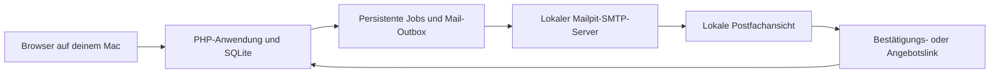

# Corpsakademie 2.0 – Machbarkeit und Weg zum installierbaren Produkt

Prüfstand: 24. Oktober 2026. Grundlage: Architekturentwurf und lokale Umgebungsprüfung. Es wurde keine Anwendung implementiert, keine Software installiert und keine Kundeninfrastruktur verändert.

**Nachtrag nach Freigabe des ersten technischen Schritts:** PHP wurde inzwischen auf 8.5.12 aktualisiert, Composer 2.10.3 und Mailpit 1.32.0 sind installiert. Datenbankprüfung und lokaler SMTP-Test waren erfolgreich. Die folgenden Angaben zum Installationsbedarf beschreiben den Vorzustand dieser Machbarkeitsanalyse. Der aktuelle Stand und die Start-/Prüfbefehle stehen in [Lokale Entwicklungsumgebung](LOKALE_ENTWICKLUNG.md).

**Nachtrag zum folgenden Entwicklungspaket:** Das erste ausführbare Fundament einschließlich Identitätsmodul ist nun lokal umgesetzt. Die Abgrenzung zu den noch offenen Geschäftsmodulen und die geprüften Sicherheitsabläufe stehen in [Fundament](FUNDAMENT.md). Die Hostingfreigabe für den unbekannten Kundenserver bleibt offen.

**Nachtrag zur Datenbankentscheidung:** Der Auftraggeber hat sich für PostgreSQL entschieden; die Anwendung wurde von SQLite auf PostgreSQL ab Version 10 umgestellt. Alle SQLite-bezogenen Prüfungen, Anforderungen und Bewertungen weiter unten beschreiben deshalb den damaligen Prüfstand vom 24. Oktober 2026 und sind nicht mehr der aktuelle Stand. Verbindlich sind die PostgreSQL-Abschnitte in [Architektur und offene Geschäftsentscheidungen](ARCHITEKTUR.md) und die Einrichtung in [Namecheap/cPanel](NAMECHEAP.md).

## Ergebnis

**Die Plattform kann auf dem vorhandenen Mac entwickelt werden.** Die benötigten PHP-Erweiterungen sind vorhanden; grundlegende SQLite-Funktionen einschließlich Schreibsperre zwischen zwei Prozessen und konsistentem Backup funktionieren. Vor dem Aufbau sind der PHP-Patchstand zu aktualisieren und die Entwicklungswerkzeuge zu ergänzen.

Der Auftraggeber hat als Vorgehen gewählt: Entwicklung auf dem Mac, anschließend Abnahme auf einem Testserver. Das Ziel ist das vollständige spezifizierte Produkt mit einem beim Kunden installierbaren Release. Der konkrete Kundenhost und Tarif sind noch unbekannt. Dessen Eignung kann deshalb noch nicht bestätigt werden.

Die Empfehlung lautet: lokale Umsetzung freigeben, technische Anforderungen an den Zielserver jetzt festhalten und die tatsächliche Hostingkompatibilität prüfen, sobald ein Tarif bekannt ist. Die Kundeninstallation erfolgt nach Produktabnahme; eine frühe Hostingprüfung erfordert keine vorzeitige Veränderung der Kundenwebsite.

## 1. Tatsächlich geprüfte lokale Voraussetzungen

| Prüffeld | Festgestellter Zustand | Bewertung |
|---|---|---|
| Rechner | macOS 26.5, ARM64 | Für lokale PHP-Entwicklung geeignet |
| Speicherplatz | Rund 48 GiB frei | Für den Entwicklungsstart ausreichend; Container, Medien und Backups im Blick behalten |
| PHP | 8.5.3, Homebrew, CLI funktioniert | Geeigneter Versionszweig; vor Einrichtung aktualisieren |
| SQLite in PHP | PDO_SQLite und SQLite3 verwenden 3.54.1 | Tatsächlich verwendete Bibliothek geprüft |
| PHP-Erweiterungen | mbstring, intl, fileinfo, OpenSSL, Sodium, GD, DOM, XML, cURL und ZIP vorhanden | Geplante Verarbeitung von Text, Bildern, Kryptografie, Mail und PDF grundsätzlich möglich; konkrete Bibliotheken noch zu prüfen |
| Passwortverfahren | Argon2id verfügbar | Geeignete Grundlage für sichere Passwortspeicherung |
| Composer | Nicht im Suchpfad gefunden; nicht unter den abgefragten Homebrew-Paketen | Vor Implementierung ergänzen |
| Node.js / npm | 26.12.1 / 11.20.0 vorhanden | Werkzeuge für Frontend-Assets vorhanden; keine Produktionspflicht daraus ableiten |
| Docker | CLI vorhanden; Engine am konfigurierten Socket nicht erreichbar | Für erste native Entwicklung nicht erforderlich; für lokale Linux-Tests erst betriebsbereit machen |
| Git | main mit origin/main synchronisiert | Versionsverwaltung und vorhandener Architekturstand nutzbar |
| Mailpit | Nicht im Suchpfad gefunden | SMTP-Testserver vor Mailintegration ergänzen |

Der installierte PHP-Patchstand ist älter als die aktuelle Sicherheitsveröffentlichung 8.5.12. Vor dem Betrieb eines Entwicklungs-Webservers soll PHP auf einen aktuellen korrigierten Patchstand gebracht werden. Das PHP-Projekt empfiehlt die Aktualisierung ausdrücklich. [PHP-Sicherheitsveröffentlichung](https://news-web.php.net/php.announce/513)

Der separat aufgerufene Systembefehl sqlite3 meldet eine andere, ältere Version als PHP. Anwendung, Backups und Tests sollen deshalb denselben ausdrücklich geprüften SQLite-Zugang verwenden. Die Funktionstests unten liefen über PHP.

### Kurztest in einer temporären Datenbank

Erfolgreich geprüft wurden:

- WAL lässt sich aktivieren.
- Foreign Keys sind aktiviert und weisen einen ungültigen Verweis ab.
- BEGIN IMMEDIATE blockiert einen konkurrierenden Schreibversuch aus einem zweiten PHP-Prozess.
- Rollback entfernt die nicht bestätigte Änderung.
- VACUUM INTO erzeugt einen lesbaren Sicherungsstand.
- Integritätsprüfung der Sicherung meldet ok; Datensatzanzahl stimmt und Foreign-Key-Prüfung bleibt fehlerfrei.

Die Testdateien wurden anschließend entfernt. Dieser Nachweis betrifft die Entwicklungsumgebung. Er ist noch kein Nachweis für Doppelbuchungsschutz oder andere Funktionen der späteren Anwendung. Der Arbeitsspeicher wurde nicht verlässlich ermittelt; eine Kapazitätsaussage für spätere Container- oder Lasttests ist damit nicht verbunden.

## 2. Lokale Mail- und Newslettertests

**Ja: Die Mailfunktionen können auf dem Mac entwickelt und durchgängig getestet werden.** Vorgesehen ist Mailpit als lokaler SMTP-Empfänger mit Postfachansicht im Browser und API für automatisierte Prüfungen. Die Anwendung verwendet ihren normalen SMTP-Adapter. In der Entwicklung endet dieser Versandweg bei Mailpit. [Mailpit](https://mailpit.axllent.org/), [SMTP-Anbindung](https://mailpit.axllent.org/docs/usage/sending-messages/)

Mailpit kann als eigenständiges Programm auf macOS laufen; Docker ist dafür nicht zwingend erforderlich. Standardmäßig sind SMTP-Port 1025 und Weboberfläche 8025 vorgesehen. Für die lokale Einrichtung werden die veröffentlichten Ports ausdrücklich auf den eigenen Rechner beschränkt. Automatische Weiterleitung und externe SMTP-Relays bleiben ausgeschaltet. [Installation](https://mailpit.axllent.org/docs/install/)

Testempfänger wie kunde@example.test und referent@example.test landen in derselben geschützten Postfachansicht und bleiben nach Empfänger unterscheidbar. Links verweisen auf die lokale Anwendung. Eine eigene Kundendomain und echte Kundenpostfächer sind dafür noch nicht nötig. Später wird der SMTP-Endpunkt über Konfiguration ausgetauscht.

| Funktion | Lokal nachweisbar | Zusätzliche spätere Prüfung |
|---|---|---|
| Anfrage bestätigen | Mail erzeugt, Link nutzbar, Frist und Einmalverbrauch korrekt | Tatsächliche externe Zustellung und produktive URL |
| Referenten einladen | Richtige Empfänger, Inhalte und berechtigte Antwort | Reale Benutzerkonten und produktive Zustellbarkeit |
| 24/48/72-Stunden-Regeln | Steuerbare Testuhr, fällige Jobs, Deduplizierung, Ablauf und Ersatz | Langzeitbetrieb des Schedulers auf Linux |
| Kostenvoranschlag | Richtige Version, PDF-Anhang, Annahme und Ablauf | Produktive Absender und freigegebene Geschäftsinhalte |
| Newsletter erstellen | Betreff, HTML, Textalternative, Bilder, Links, Vorschau und Testversand | Darstellung in den vereinbarten echten Mailclients |
| Newsletter planen | Startzeit, Zeitzone, Planänderung, Stopp, Wiederanlauf | Echte Cron-Toleranz, Mailquote und Laufzeitgrenzen |
| Double-Opt-in | Keine reguläre Kampagne vor Bestätigung | Produktive Einwilligungstexte und Nachweiskonzept |
| Abmeldung | Keine weiteren Übergaben nach Abmeldung; One-Click-Endpunkt | Verhalten des echten Mailanbieters und DKIM-signierte Header |
| Empfängerfilter | Keine unbestätigten, abgemeldeten oder doppelt ausgewählten Empfänger | Reale Verteilergröße und Versandfenster |
| Versandfehler | Simulierte SMTP-Fehler, Backoff, unklare Übertragung und administrative Klärung | Konkrete Providerantworten, Limits und Zustellereignisse |
| Rückläufer | Verarbeitung künstlicher Rückläufer-/Webhook-Testdaten | Tatsächlicher Bounce-Rückkanal des gewählten Versanddienstes |

Für automatisierte Tests lässt sich Mailpit per API auslesen. Damit kann geprüft werden, ob etwa genau eine Bestätigung mit dem richtigen Link an den richtigen Testempfänger erzeugt wurde. Konfigurierbare SMTP-Fehler unterstützen die Prüfung von Wiederholungen und Fehlerbehandlung. [Mailpit-API](https://mailpit.axllent.org/docs/api-v1/), [Projektfunktionen](https://github.com/axllent/mailpit)

**Die externe Zustellbarkeit bleibt eine eigene Abnahme:** DNS-Einträge, SPF, DKIM, DMARC, Absenderreputation, reale Spamfilter und Anbieterquoten benötigen den tatsächlichen Versanddienst und eine freigegebene Domain. Mailpit belegt außerdem nicht automatisch, dass ein Newsletter in Outlook und Gmail identisch aussieht. Die Serververfügbarkeit bei zugeklapptem oder ausgeschaltetem Mac ist ebenfalls kein sinnvoller lokaler Dauerbetriebstest.

## 3. Entwicklungs-, Abnahme- und Lieferprozess

### Stufe A – Vollständiges Produkt auf dem Mac entwickeln

Die Entwicklungsumgebung besteht aus aktuellem PHP, Composer, SQLite, Browser und Mailpit. Sämtliche Fachmodule aus dem Architekturentwurf werden schrittweise vollständig implementiert und verbunden: Website, Administration, Referentenportal, Kalender, Buchungskoordination, Erinnerungen, Angebote und Newsletter. Kleine Pakete dienen der überprüfbaren Fertigstellung des Gesamtprodukts.

Jedes Modul erhält reale Datenhaltung, Berechtigungsprüfungen, aussagekräftige Fehlerpfade und die erforderlichen Tests. Zeitabhängige Vorgänge werden mit steuerbarer Uhr getestet. Parallele Buchungen werden mit getrennten Prozessen gegen eine echte temporäre SQLite-Datei geprüft. Testdaten und Mail-Sink bleiben von späteren Produktionsdaten getrennt.

### Stufe B – Früh auf Linux und der vorgesehenen Hostingklasse prüfen

Sobald das Fundament steht, wird die Installation in einer sauberen Linux-Umgebung wiederholt. Das kann zunächst ein lokaler Container sein. ARM64 des Macs und eine mögliche AMD64-Kundenmaschine müssen bei Containerimages berücksichtigt werden; Docker unterstützt passende Plattformvarianten beziehungsweise Emulation. Ein konkretes Image ist später anhand der Zielplattform zu prüfen. [Docker-Plattformen](https://docs.docker.com/build/building/multi-platform/)

Eine Linux-Testumgebung prüft unter anderem Groß-/Kleinschreibung von Pfaden, Dateirechte, PHP-Erweiterungen, SQLite-Locking und CLI-Läufe. Ein Container allein bildet die Einschränkungen eines Shared-Hosting-Tarifs nicht vollständig ab. PHP-Konfiguration, Prozess- und Maillimits des tatsächlichen Tarifs bleiben ein eigener Test.

### Stufe C – Produktabnahme auf einem geschützten Testserver

Auf dem späteren Testserver wird derselbe Releaseprozess verwendet, der auch für den Kunden vorgesehen ist. Abgenommen werden vollständige Kundenvorgänge, Referentenreaktionen, Fristen, Fehler, Neustarts, Newsletter, Backups und Wiederherstellung. Design und Bedienbarkeit werden mit dem Auftraggeber auf Mobilgeräten und Desktop geprüft. Mit ausgewähltem SMTP-Dienst erfolgen gezielte Zustelltests an freigegebene Testpostfächer.

Der konkrete Testserver, Betreiber und Tarif sind noch nicht festgelegt. Für die erste lokale Umsetzung ist kein eigener öffentlich erreichbarer Server erforderlich. Zur Abnahme muss eine geeignete Umgebung rechtzeitig verfügbar sein.

### Stufe D – Installierbares Release bauen

Die Übergabe enthält Anwendungscode, festgeschriebene Produktionsabhängigkeiten, fertige Frontend-Assets, Migrationen, Installer, Konfigurationsvorlage, Diagnose, Versionsmanifest und Handbücher. Eine frische Installation startet mit einer neuen SQLite-Datenbank und übernimmt nur ausdrücklich freigegebene Stammdaten und Medien. Testbuchungen, Testabonnenten, Testkonten, Testschlüssel und offene Entwicklungsjobs werden nicht als Produktivbestand kopiert.

Die Installationsprobe beginnt in einer leeren kompatiblen Umgebung. Konfiguration, Migrationen, erstes Administratorkonto, MFA, Schreibrechte und Diagnose müssen ohne Änderungen am Programmcode funktionieren. Der Kunde braucht keinen laufenden Mac des Entwicklers. Docker und Node.js werden auf dem Kundenserver nicht zwingend vorausgesetzt.

### Stufe E – Beim Kunden installieren und abschließend prüfen

Erst nach Abnahme werden Release, freigegebene Inhalte und produktive Konfiguration installiert. HTTPS, Domain, Absender, SMTP, Cron und Backups werden auf dem Zielsystem eingerichtet und geprüft. Ein kontrollierter Funktionstest auf dem Kundensystem gehört zur Installation, auch wenn das Produkt vorher vollständig abgenommen wurde. Bei einem Relaunch werden alte Website, Inhalte und URLs vorab gesichert und die Umschaltung mit Rückfallverfahren geplant.

## 4. Anforderungen an den noch unbekannten Kundenhost

Die Anwendung bleibt anbieterneutral, braucht aber einen überprüfbaren technischen Rahmen:

- Gepflegtes PHP samt benötigten Erweiterungen (`pdo_pgsql`, `pgsql`), kompatibler CLI und erreichbarem PostgreSQL ab Version 10.
- Geeigneter privater Speicher für Protokolle, Medien und Sicherungen; Konfiguration und Datenbankzugang außerhalb des Webroots.
- Zulässige zeitgesteuerte PHP-CLI-Ausführung mit ausreichenden Laufzeit- und Speicherlimits.
- HTTPS, korrekte Domainkonfiguration und geschützte Geheimnisse.
- Ausreichende SMTP-Quote, erlaubte Versandidentitäten und nutzbarer Rückläuferweg.
- Gesicherte Backups, Restoremöglichkeit und Zugriff auf notwendige Betriebsprotokolle.

Bei Namecheap Shared Hosting ist insbesondere das dokumentierte Mindestintervall von fünf Minuten für Cron zu berücksichtigen. Versandplanung bedeutet dann den nächsten erfolgreichen Lauf ab Fälligkeit. Newsletterumfang und Mailquote müssen zusammenpassen. Ein genauer Zeitpunkt mit sehr geringer Toleranz kann eine andere Hostingklasse erfordern. [Cron-Vorgaben](https://www.namecheap.com/support/knowledgebase/article.aspx/9453/29/how-to-run-scripts-via-cron-jobs/), [Mailquoten](https://www.namecheap.com/support/knowledgebase/article.aspx/133/22/do-you-have-any-restrictions-on-sending-out-emails/)

Solange kein Tarif feststeht, lautet die Aussage: **lokale Entwicklung machbar, Zielinstallation unter definierten Voraussetzungen machbar, konkreter Kundenserver noch nicht freigegeben.** Ein ungeeigneter Tarif muss vor der Übergabe gewechselt werden; „bei jedem beliebigen Hoster installierbar“ ist kein belastbares Produktversprechen.

## 5. Was „fertig“ vor der Kundeninstallation bedeutet

Das Produkt ist zur Übergabe bereit, wenn:

1. Alle vereinbarten Module tatsächlich implementiert und durchgängig verbunden sind.
2. Individuelle Gruppen versus öffentliche Einzelplatzveranstaltungen, Preisregeln, Gesamtfristen, Reservierungen, Verbindlichkeit und Stornierung verbindlich festgelegt sind.
3. Alle vier Referentenmodi und die relevanten Konkurrenz-, Ablauf-, Ersatz- und Angebotsfälle erfolgreich geprüft sind.
4. Newsletter einschließlich Planung, Einwilligung, Abmeldung, Versandfehlern und unveränderlichem Archiv abgenommen ist.
5. Rollen, MFA, Datensatzbesitz, Token, Uploads und öffentliche Datenfreigaben die festgelegten Sicherheitsprüfungen bestehen.
6. Bedienbarkeit, Inhalte, mobile Ansichten, Mailvorlagen und PDFs freigegeben sind.
7. Eine frische Installation sowie Backup und Wiederherstellung nachweislich funktionieren.
8. Zielhosting, Versandvolumen, Verantwortlichkeiten und der Wartungsweg feststehen.
9. Keine offenen kritischen oder hohen Fehler die vereinbarten Kernabläufe oder den Schutz von Daten beeinträchtigen.

„Perfekt“ wird damit in überprüfbare Abnahmekriterien übersetzt. Fehlerfreiheit für alle denkbaren Situationen lässt sich nicht garantieren. Die reguläre Wartung und Sicherheitsupdates bleiben auch nach einer erfolgreichen Übergabe notwendig.

## 6. Empfohlener nächster Schritt

Zuerst wird die lokale Umgebung reproduzierbar eingerichtet: PHP aktualisieren, Composer und Mailpit ergänzen, Start/Stop und lokale Testkonfiguration dokumentieren. Anschließend erfolgt ein kurzer Nachweis „PHP-Anwendung → SMTP → lokale Postfachansicht“ und die Vorbereitung der Linux-Installationsprüfung. Das ist der erste technische Umsetzungsschritt nach Freigabe dieser Analyse; er wurde hier noch nicht ausgeführt.

Die offene Hostingwahl verhindert diesen lokalen Start nicht. Vor der Buchungs-Engine müssen die grundlegenden Geschäftsentscheidungen aus dem Architekturentwurf getroffen werden. Der nächste fachliche Punkt ist die Entscheidung zwischen individuellen Gruppenseminaren und zusätzlicher Einzelplatzbuchung für öffentliche Veranstaltungen.
